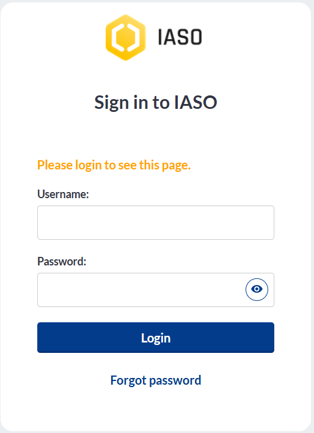
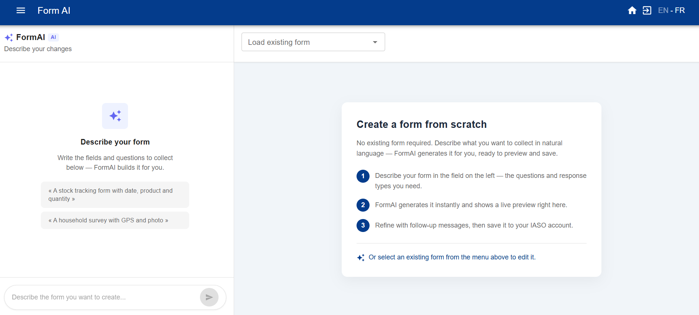
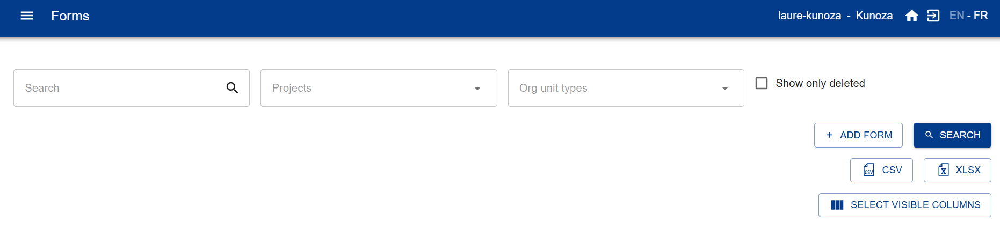
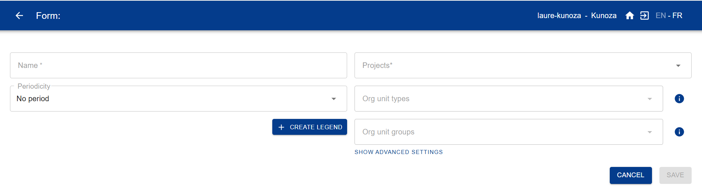

# Welcome to the documentation of IASO

## Introduction to IASO

IASO is an innovative, open-source, trilingual (EN/FR/ES) **data collection platform with advanced geospatial features** to plan, monitor and evaluate health, environmental or social programmes in low- and middle-income settings (LMICs). IASO is recognized as a **Digital Public Good** by the Digital Public Good Alliance and listed as a Digital Square Software **Global Good**, a testament to its proven impact.
For more information and detailed use cases, please visit [IASO website](https://www.openiaso.com/).

!!! tip "New to IASO?"
    Follow the **[Get started with IASO](#get-started-with-iaso)** guide to subscribe to a plan, log in, and create your first data collection form.

IASO comprises:

- a **web dashboard** - intended for supervisors to organize data collection and geographical data management
- a **mobile application** that also works **offline** - intended to field users to fill out forms and send data when network is available
- a **matching and scripting interface** to analyze, compare and merge several geographic data sources
- a bi-directional **integration with DHIS2**, the widely used Health Management Information System in Low- and middle-income countries

The platform has been implemented in Benin, Burkina Faso, Burundi, Cameroon, Central African Republic, the Democratic Republic of Congo, Haiti, Ivory Coast, Mali, Niger, Nigeria and Uganda. It is the official georegistry in Burkina Faso since 2023. IASO has also been implemented at regional level (AFRO region) in support to the Global Polio Eradication Initiative for its geospatial and health facility registries capabilities.

## Features

In terms of features, IASO can be summarized around **four main components** which are interconnected and expand the powers of one another:

### Geospatial data management (Georegistry)

-  Manage multiple master lists of organizational units (e.g. health areas, districts, facilities, or schools) including their GPS coordinates and boundaries
-  Keep track of changes made to the organization units
-   Map multiple geographic data sources
-   Propose changes to org units from IASO mobile application and validate them on the web

### Geo-structured data collection

-   Create data collection forms using the widely known XLS form format and upload them to IASO
-   Link your form to one or several organization unit type (e.g. National/Regional/District/Health facility) to geo-structure your data collection
-   Keep track of changes with versioning of your data collection forms
-   Validate from the web all data collection form submissions sent from IASO mobile application
-   Monitor data collection completeness per organization unit level and drill-down to identify where issues happen

### Microplanning

- Manage teams of users and teams of teams
- Assign data collection duties to teams and users using a map interface
- Create plannings with a scope, a time span, and one or several data collection form(s)

### Entities (longitudinal tracking)

These can be individuals (e.g. health programme beneficiaries) or physical objects (e.g. vaccines parcel, mosquito net, etc.). Workflows allows the tracking of entities by opening specific forms according to previous answers given to previous forms.

- Create entity types (beneficiaries, stocks, or other)
- Assign workflows to entity types
- Register entities via mobile app (offline)
- Synchronize mobile and web applications
- Compare and merge entities as needed
- Record entity data in an NFC card

## Get started with IASO

*A first-timer's guide to basic configuration.*

This guide is for account administrators setting up a new IASO SaaS account for the first
time. It covers subscribing to a plan, logging in, setting up your geographical data,
creating your first data collection form, and connecting the mobile app.

### 1. Subscribe to IASO

If you haven't subscribed yet, go to [openiaso.com/pricing](https://www.openiaso.com/pricing/)
and choose a plan. If you're not sure yet, you can start with a free trial to try out the
product.

You'll then receive an email with instructions to create your account.

### 2. Connect to your account

Go to [app.openiaso.com](https://app.openiaso.com/).

Enter your credentials and click "Login".

{ .doc-shot }

### 3. Set up your geographical data

Your geographical data appears under the "Org Units" menu. It's empty by default on a new
account. You can set it up manually, or by importing a geopackage file (a standard file
format for geographic boundary data).

**Manual configuration**

- Go to "Org Units" > "Configuration" > "Organisation unit type"
- Create the organisation unit types that match the geographical levels in your data (e.g.
  country, region, district, facility)
- See the [organisation unit types guide](./pages/users/reference/user_guide.md#organization-unit-types-management)
  for more detail

**Import a geopackage**

- Go to "Admin" > "Data sources list" > "Create"
- Name your data source and assign it to one or more projects
- Your geopackage file needs to follow this format: [GeoPackage format](./pages/users/reference/geopackage_format.md)

### 4. Create your data collection forms

Go to the "Forms" menu. You can create a form in two ways:

**Option A — Generate a form with Form AI**

- Go to "Forms" > "Form AI"

{ .doc-shot }

- Describe the form you want in a prompt: list the questions you need, specify whether each
  should be an open question or closed with pre-selected fields, and mention any skip logic.
- IASO generates a form you can preview and adjust on the right-hand side. Save it once
  you're happy with it.

**Option B — Import an existing XLS form**

- Go to "Forms" > "Form list" > "Add form"

{ .doc-shot }

Then fill in the fields:

- Form name (mandatory)
- Project (mandatory)
- Org unit type (recommended)
- Org unit group (only if relevant, otherwise leave blank)
- Period (only if relevant, otherwise leave blank)

{ .doc-shot }

### 5. Download the IASO mobile app

Get the IASO mobile app on the Google Play Store: [play.google.com](https://play.google.com/store/apps/details?id=com.bluesquarehub.iaso&hl=en)

### 6. Scan the QR code and get started

On the IASO web application, go to "Projects". Make sure the required feature flags are
activated for your project. Then, click the QR code for your project. Scan it from the
mobile app to finish setup.

## Technical stack

IASO is made of a white labeled Android application using Java/Kotlin, reusing large parts of the ODK projects, and a web platform programmed using Python/GeoDjango on top of PostGIS. 
Frontend is mainly React/Leaflet. 
The API is implemented via Django rest framework, all data is stored in Postgresql or the media/ directory. One of the aims is the ease of integration with other platforms. We already have csv and geopackage imports and exports and target easy integration with OSM.

The companion mobile app for Android allows form submission and and org unit creation.
Forms can also be filled in a web interface via the Enketo companion service. 
