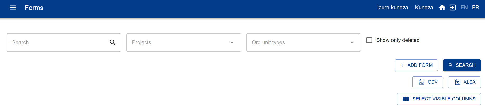
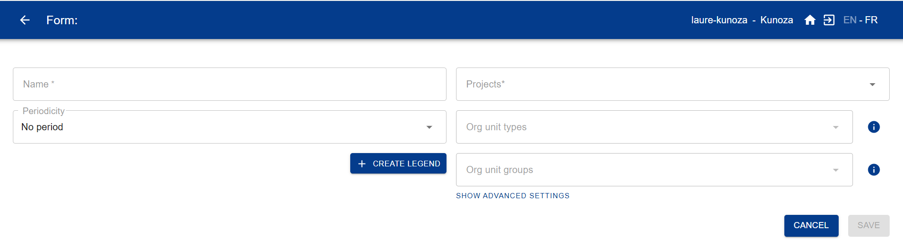

# Bienvenido a la documentación de IASO

## Introducción a IASO
IASO es una plataforma innovadora, de código abierto, trilingüe (EN/FR/ES) de **recolección de datos con funcionalidades geoespaciales avanzadas** para planificar, monitorear y evaluar programas de salud, ambientales o sociales en países de ingresos bajos y medios (PIBM). IASO es reconocido como un **Bien Público Digital** por la Alianza de Bienes Públicos Digitales y figura entre los software **Global Goods** de Digital Square, testimoniando su utilidad pública.

!!! tip "¿Nuevo en IASO?"
    Siga la guía **[Primeros pasos con IASO](#primeros-pasos-con-iaso)** para suscribirse a un plan, iniciar sesión y crear su primer formulario de recolección de datos.

IASO incluye:

- un **tablero web** - destinado a supervisores para organizar la recolección de datos y la gestión de datos geográficos
- una **aplicación móvil** que también funciona **sin conexión** - destinada a usuarios de campo para completar formularios y enviar datos cuando la red esté disponible
- una **interfaz de correspondencia y script** para analizar, comparar y fusionar múltiples fuentes de datos geográficos
- una **integración bidireccional con DHIS2**, el sistema de información de gestión de salud ampliamente utilizado en los PIBM

La plataforma ha sido implementada en Benín, Burkina Faso, Burundi, Camerún, República Centroafricana, República Democrática del Congo, Haití, Costa de Marfil, Mali, Níger, Nigeria y Uganda. Es el registro geográfico oficial en Burkina Faso desde 2023. IASO también ha sido implementado a nivel regional (región AFRO) para apoyar la Iniciativa Global para la Erradicación de la Polio gracias a sus capacidades de registros geoespaciales y de establecimientos de salud.

## Funcionalidades

En términos de funcionalidades, IASO puede resumirse en torno a **cuatro componentes principales** que están interconectados y refuerzan sus capacidades mutuas:

### Gestión de datos geoespaciales (Georegister)

- Gestionar múltiples listas de unidades organizacionales (por ejemplo, zonas de salud, distritos, establecimientos de salud o escuelas) incluyendo sus coordenadas GPS y fronteras
- Rastrear las modificaciones realizadas a las unidades organizacionales
- Comparar múltiples fuentes de datos geográficos
- Proponer modificaciones a las unidades organizacionales desde la aplicación móvil IASO y validarlas en la web

### Recolección de datos geo-estructurados

- Crear formularios de recolección de datos utilizando el popular formato XLS e importarlos en IASO
- Vincular sus formularios a uno o varios tipos de unidades organizacionales (por ejemplo, Nacional/Regional/Distrito/Establecimiento de salud) para estructurar geográficamente su recolección de datos
- Rastrear los cambios con la gestión de versiones de sus formularios
- Validar desde la web todas las presentaciones de formularios enviadas por la aplicación móvil IASO
- Rastrear la completitud de la recolección de datos por nivel de unidades organizacionales e identificar dónde se encuentran los problemas

### Microplanificación

- Gestionar equipos de usuarios y equipos de equipos
- Asignar tareas de recolección de datos a equipos y usuarios utilizando un mapa interactivo
- Crear calendarios con un perímetro, duración y uno o más formularios de recolección de datos

### Entidades (seguimiento longitudinal)

Estas pueden consistir en individuos (por ejemplo, beneficiarios de programas de salud) u objetos físicos (por ejemplo, lotes de vacunas, mosquiteros, etc.). Los flujos de trabajo permiten rastrear las entidades abriendo formularios específicos en función de las respuestas dadas a formularios anteriores.

- Crear tipos de entidades (beneficiarios, stocks u otros)
- Asignar flujos de trabajo a tipos de entidades
- Registrar entidades a través de la aplicación móvil (sin conexión)
- Sincronizar las aplicaciones móvil y web
- Comparar y fusionar entidades si es necesario
- Registrar los datos de las entidades en una tarjeta NFC

## Primeros pasos con IASO

*Una guía para la primera configuración básica.*

Esta guía está dirigida a los administradores de cuenta que configuran una nueva cuenta SaaS
de IASO por primera vez. Cubre la suscripción a un plan, el inicio de sesión, la configuración
de sus datos geográficos, la creación de su primer formulario de recolección de datos y la
conexión de la aplicación móvil.

### 1. Suscribirse a IASO

Si aún no se ha suscrito, vaya a [openiaso.com/pricing](https://www.openiaso.com/pricing/) y
elija un plan. Si todavía no está seguro, puede comenzar con una prueba gratuita para probar
el producto.

Luego recibirá un correo electrónico con las instrucciones para crear su cuenta.

### 2. Conectarse a su cuenta

Vaya a [app.openiaso.com](https://app.openiaso.com/).

Introduzca sus credenciales y haga clic en "Login".

### 3. Configurar sus datos geográficos

Sus datos geográficos aparecen en el menú "Org Units" (Unidades Organizacionales). Está vacío
por defecto en una cuenta nueva. Puede configurarlo manualmente, o importando un archivo
geopackage (un formato de archivo estándar para datos de límites geográficos).

**Configuración manual**

- Vaya a "Org Units" > "Configuration" > "Organisation unit type" (Tipo de Unidad
  Organizacional)
- Cree los tipos de Unidad Organizacional que correspondan a los niveles geográficos de sus
  datos (por ejemplo, país, región, distrito, centro de salud)
- Consulte la [guía de tipos de Unidad Organizacional](./pages/users/reference/user_guide.md#gestion-de-tipos-de-unidades-organizacionales)
  para más detalles

**Importar un geopackage**

- Vaya a "Admin" > "Data sources list" (Lista de fuentes de datos) > "Create"
- Nombre su fuente de datos y asígnela a uno o varios proyectos
- Su archivo geopackage debe seguir este formato: [formato GeoPackage](./pages/users/reference/geopackage_format.md)

### 4. Crear sus formularios de recolección de datos

Vaya al menú "Forms" (Formularios). Puede crear un formulario de dos maneras:

**Opción A — Generar un formulario con Form AI**

- Vaya a "Forms" > "Form AI"
- Describa el formulario que desea en una instrucción: enumere las preguntas que necesita,
  especifique si cada una debe ser una pregunta abierta o cerrada con opciones predefinidas, y
  mencione cualquier lógica de salto.
- IASO genera un formulario que puede previsualizar y ajustar en el panel derecho. Guárdelo
  una vez que esté satisfecho con el resultado.

**Opción B — Importar un formulario XLS existente**

- Vaya a "Forms" > "Form list" > "Add form"

{ .doc-shot }

Luego complete los campos:

- Nombre del formulario (obligatorio)
- Proyecto (obligatorio)
- Tipo de Unidad Organizacional (recomendado)
- Grupo de Unidad Organizacional (solo si es relevante, de lo contrario déjelo en blanco)
- Período (solo si es relevante, de lo contrario déjelo en blanco)

{ .doc-shot }

### 5. Descargar la aplicación móvil de IASO

Obtenga la aplicación móvil de IASO en Google Play Store: [play.google.com](https://play.google.com/store/apps/details?id=com.bluesquarehub.iaso&hl=es)

### 6. Escanear el código QR y comenzar

En la aplicación web de IASO, vaya a "Projects" (Proyectos). Asegúrese de que los indicadores
de funcionalidad necesarios estén activados para su proyecto. Luego, haga clic en el código QR
de su proyecto. Escanéelo desde la aplicación móvil para finalizar la configuración.

## Tecnologías utilizadas
IASO está compuesto por una aplicación Android white labeled utilizando Java/Kotlin, reutilizando una gran parte de los proyectos ODK, y una plataforma web programada en Python/GeoDjango sobre PostGIS. El frontend es principalmente en React/Leaflet. La API está implementada a través de Django Rest Framework, y todos los datos se almacenan en PostgreSQL o el directorio media/. Uno de los objetivos es la facilidad de integración con otras plataformas. Ya tenemos importaciones y exportaciones en formatos CSV y GeoPackage, y apuntamos a una fácil integración con OSM.

La aplicación móvil para Android permite la presentación de formularios y la creación de unidades organizacionales. Los formularios también pueden completarse en una interfaz web a través del servicio complementario Enketo.
