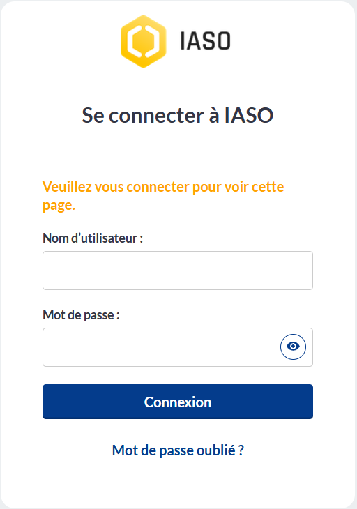
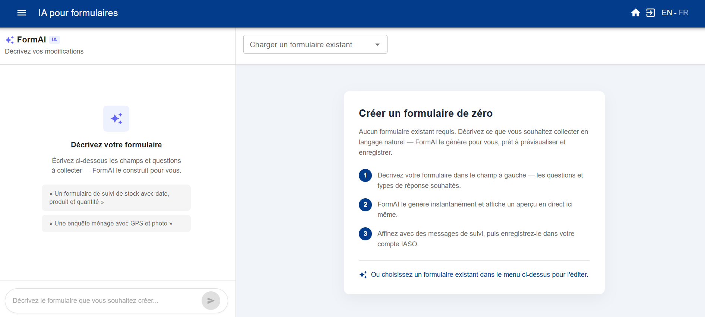
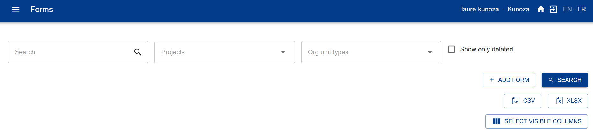
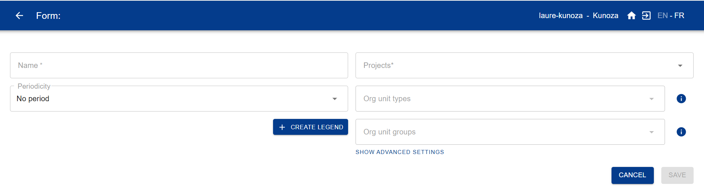

# Bienvenue dans la documentation d'IASO

## Introduction à IASO
IASO est une plateforme innovante, open-source, trilingue (EN/FR/ES) de **collecte de données à fonctionnalités géospatiales avancées** pour planifier, surveiller et évaluer les programmes de santé, environnementaux ou sociaux dans les pays à revenu faible et intermédiaire (PRFI). IASO est reconnu comme un **Bien Public Numérique** par l'Alliance des Biens Publics Numériques et figure parmi les logiciels **Global Goods** de Digital Square, témoignant de son utilité publique.

!!! tip "Nouveau sur IASO ?"
    Suivez le guide **[Bien démarrer avec IASO](#bien-demarrer-avec-iaso)** pour vous abonner à une offre, vous connecter et créer votre premier formulaire de collecte de données.

IASO comprend :

- un **tableau de bord web** - destiné aux superviseurs pour organiser la collecte de données et la gestion des données géographiques
- une **application mobile** qui fonctionne également **hors ligne** - destinée aux utilisateurs sur le terrain pour remplir des formulaires et envoyer des données lorsque le réseau est disponible
- une **interface de correspondance et de script** pour analyser, comparer et fusionner plusieurs sources de données géographiques
- une **intégration bidirectionnelle avec DHIS2**, le système d'information de gestion de la santé largement utilisé dans les PRFI

La plateforme a été mise en œuvre au Bénin, au Burkina Faso, au Burundi, au Cameroun, en République Centrafricaine, en République Démocratique du Congo, en Haïti, en Côte d'Ivoire, au Mali, au Niger, au Nigéria et en Ouganda. Elle est le registre géographique officiel au Burkina Faso depuis 2023. IASO a également été mise en œuvre au niveau régional (région AFRO) pour soutenir l'Initiative Mondiale pour l'Eradication de la Polio grâce à ses capacités de registres géospatiaux et d'établissements de santé.

## Fonctionnalités

En termes de fonctionnalités, IASO peut être résumé autour de **quatre composantes principales** qui sont interconnectées et renforcent leurs capacités mutuelles :

### Gestion des données géospatiales (Géoregistre)

- Gérer plusieurs listes d'unités d'organisation (par exemple, zones de santé, districts, établissements de santé ou écoles) y compris leurs coordonnées GPS et frontières
- Suivre les modifications apportées aux unités d'organisation
- Comparer plusieurs sources de données géographiques
- Proposer des modifications aux unités d'organisation depuis l'application mobile IASO et les valider sur le web

### Collecte de données géo-structurées

- Créer des formulaires de collecte de données en utilisant le populaire format XLS et les importer dans IASO
- Lier vos formulaires à un ou plusieurs types d'unités organisationnelles (par exemple, National/Régional/District/Établissement de santé) pour structurer géographiquement votre collecte de données
- Suivre les changements avec la gestion des versions de vos formulaires
- Valider depuis le web toutes les soumissions de formulaires envoyées par l'application mobile IASO
- Suivre l'exhaustivité de la collecte de données par niveau d'unités d'organisation et identifier où se trouvent les problèmes

### Microplanification

- Gérer des équipes d'utilisateurs et des équipes d'équipes
- Attribuer des tâches de collecte de données aux équipes et aux utilisateurs en utilisant une carte interactive
- Créer des plannings avec un périmètre, une durée et un ou plusieurs formulaires de collecte de données

### Entités (suivi longitudinal)

Celles-ci peuvent consister en des individus (par exemple, les bénéficiaires de programmes de santé) ou des objets physiques (par exemple, des lots de vaccins, des moustiquaires, etc.). Les workflows permettent de suivre les entités en ouvrant des formulaires spécifiques en fonction des réponses données à des formulaires précédents.

- Créer des types d'entités (bénéficiaires, stocks ou autres)
- Attribuer des workflows à des types d'entités
- Enregistrer des entités via l'application mobile (hors ligne)
- Synchroniser les applications mobile et web
- Comparer et fusionner des entités si nécessaire
- Enregistrer les données des entités sur une carte NFC

## Bien démarrer avec IASO

*Un guide pour une première configuration de base.*

Ce guide s'adresse aux administrateurs de compte qui configurent un nouveau compte IASO SaaS
pour la première fois. Il couvre l'abonnement à une offre, la connexion, la configuration de
vos données géographiques, la création de votre premier formulaire de collecte de données, et
la connexion de l'application mobile.

### 1. S'abonner à IASO

Si vous n'êtes pas encore abonné, rendez-vous sur [openiaso.com/pricing](https://www.openiaso.com/pricing/)
et choisissez une offre. Si vous n'êtes pas encore sûr, vous pouvez commencer par un essai
gratuit pour découvrir le produit.

Vous recevrez ensuite un email avec les instructions pour créer votre compte.

### 2. Se connecter à votre compte

Rendez-vous sur [app.openiaso.com](https://app.openiaso.com/).

Saisissez vos identifiants et cliquez sur "Login".

{ .doc-shot }

### 3. Configurer vos données géographiques

Vos données géographiques apparaissent dans le menu "Org Units" (Unités d'organisation).
Il est vide par défaut sur un nouveau compte. Vous pouvez le configurer manuellement, ou en
important un fichier geopackage (un format de fichier standard pour les données de limites
géographiques).

**Configuration manuelle**

- Allez dans "Org Units" > "Configuration" > "Organisation unit type" (Type d'unité
  d'organisation)
- Créez les types d'unité d'organisation correspondant aux niveaux géographiques de vos
  données (par exemple pays, région, district, structure sanitaire)
- Consultez le [guide des types d'unité d'organisation](./pages/users/reference/user_guide.md#gestion-des-types-dunites-dorganisation)
  pour plus de détails

**Importer un geopackage**

- Allez dans "Admin" > "Data sources list" (Liste des sources de données) > "Create"
- Nommez votre source de données et associez-la à un ou plusieurs projets
- Votre fichier geopackage doit respecter ce format : [format GeoPackage](./pages/users/reference/geopackage_format.md)

### 4. Créer vos formulaires de collecte de données

Allez dans le menu "Forms" (Formulaires). Vous pouvez créer un formulaire de deux façons :

**Option A — Générer un formulaire avec Form AI**

- Allez dans "Forms" > "Form AI"

{ .doc-shot }

- Décrivez le formulaire souhaité dans une requête : listez les questions dont vous avez
  besoin, précisez si chacune doit être une question ouverte ou fermée avec des choix
  prédéfinis, et mentionnez toute logique de saut.
- IASO génère un formulaire que vous pouvez prévisualiser et ajuster sur la partie droite.
  Enregistrez-le une fois satisfait.

**Option B — Importer un formulaire XLS existant**

- Allez dans "Forms" > "Form list" > "Add form"

{ .doc-shot }

Renseignez ensuite les champs :

- Nom du formulaire (obligatoire)
- Projet (obligatoire)
- Type d'unité d'organisation (recommandé)
- Groupe d'unité d'organisation (uniquement si pertinent, sinon laissez vide)
- Période (uniquement si pertinent, sinon laissez vide)

{ .doc-shot }

### 5. Télécharger l'application mobile IASO

Téléchargez l'application mobile IASO sur le Google Play Store : [play.google.com](https://play.google.com/store/apps/details?id=com.bluesquarehub.iaso&hl=fr)

### 6. Scanner le code QR et démarrer

Sur l'application web IASO, allez dans "Projects" (Projets). Assurez-vous que les indicateurs
de fonctionnalité requis sont activés pour votre projet. Cliquez ensuite sur le code QR de
votre projet. Scannez-le depuis l'application mobile pour terminer la configuration.

## Technologies utilisées
IASO est composée d'une application Android white labeled utilisant Java/Kotlin, réutilisant une grande partie des projets ODK, et d'une plateforme web programmée en Python/GeoDjango sur PostGIS. Le frontend est principalement en React/Leaflet. L'API est implémentée via Django Rest Framework, et toutes les données sont stockées dans PostgreSQL ou le répertoire media/. L'un des objectifs est la facilité d'intégration avec d'autres plateformes. Nous avons déjà des imports et exports en formats CSV et GeoPackage, et nous visons une intégration facile avec OSM.

L'application mobile pour Android permet la soumission de formulaires et la création d'unités d'organisation. Les formulaires peuvent également être remplis dans une interface web via le service compagnon Enketo.
