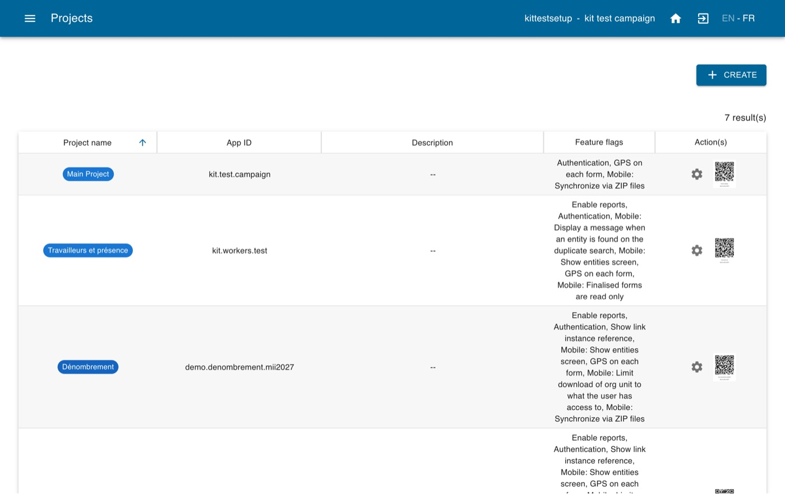
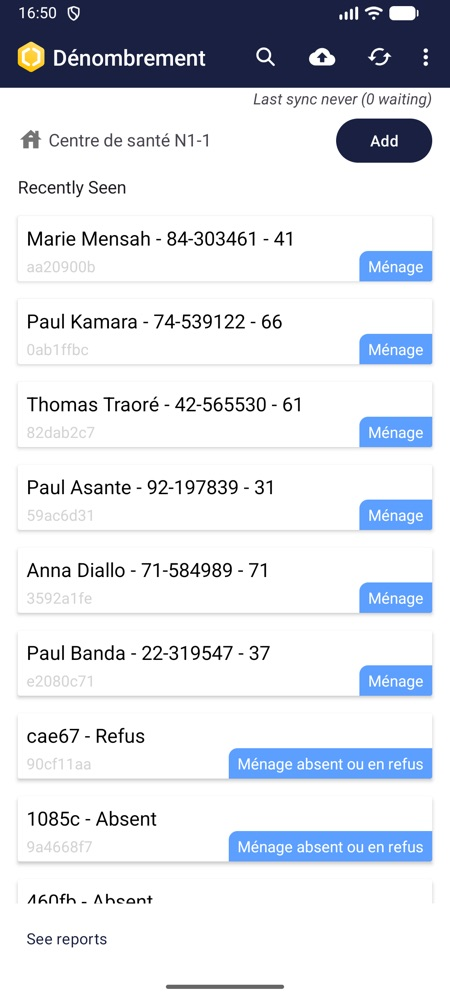
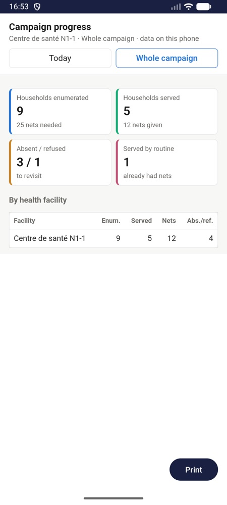
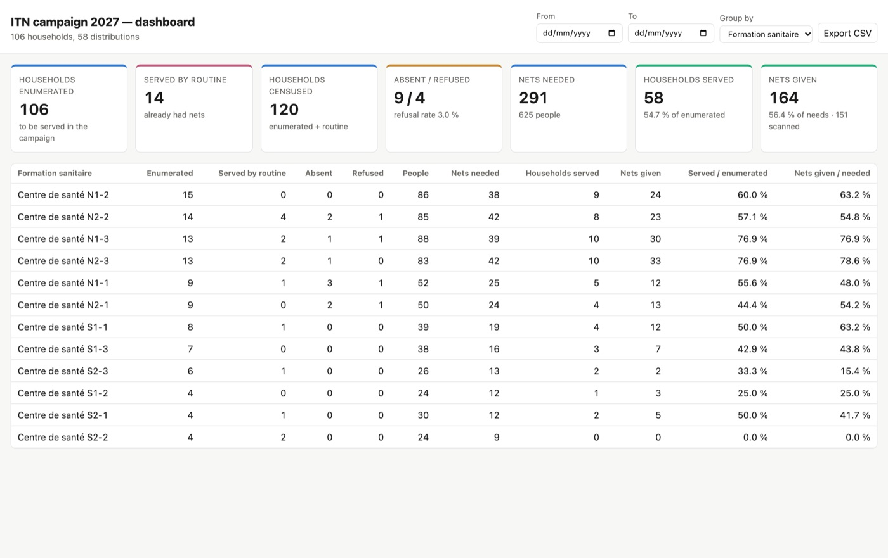

# Set up a bed net distribution campaign with AI

*Configure IASO for a mass distribution of insecticide-treated nets (ITNs) with the help of an AI assistant.*

This guide is for campaign coordinators and IT focal points who want to use IASO to plan and
monitor a bed net campaign. You don't need to be a developer: an AI assistant (Claude,
ChatGPT…) does the technical work, asks you questions about your campaign and waits for your
go-ahead before changing anything in IASO. It makes the campaign configuration quicker,
especially if most of the campaign decisions are already made.

The guide has two parts:

1. **[Prepare your IASO account](#part-1-prepare-your-iaso-account)**: create or open your
   account and choose the user for the setup.
2. **[Configure the campaign](#part-2-configure-the-campaign-with-the-campaign-kit)**: give
   the IASO campaign kit to your AI assistant and let it import your geographic data and
   build the campaign tools.

## What you get at the end

| Tool | For | What it does |
|---|---|---|
| **Mobile projects** (up to six) | enumeration agents, distribution agents, special group teams, team leaders, stock managers, supervisors | register households with a QR ticket, distribute nets once per household, register workers and their attendance, track stock movements, fill in supervision checklists |
| **15 ready-made forms** | all agents | in English and French, adapted to your allocation rule |
| **Registries** | everyone | households, special groups (prisons, camps, boarding schools…) and workers, which agents find again on the phone |
| **Stock tracking** | stock managers | balance of nets in each store, computed from receipts, issues, returns, transfers and losses |
| **Web dashboards** | coordination team | campaign progress by region, district or health facility; worker attendance and payment sheet |
| **Mobile reports** | team leaders, stock managers | progress, map of households, team attendance and stock, available offline on the phone |
| **QR codes** | trainers | to install the IASO app and configure it for each project in seconds |

{ .doc-shot }

## Before you start

| You need | Details |
|---|---|
| An **IASO account** | You can create a free trial on [openiaso.com/pricing](https://www.openiaso.com/pricing/). |
| An **AI assistant** | One that can run Python code and reach your IASO server: Claude or ChatGPT in the browser or in their app, or Claude Code (desktop app or terminal) with Python 3 on your computer. |
| Your **files and campaign decisions** | Only if you want to test with your real campaign data. Your geographic data (from DHIS2, an Excel file or a GeoPackage file: the assistant imports it for you, or you can [import it yourself](../users/reference/user_guide.md#import-a-pyramid-into-a-data-source)) and the campaign decisions: districts covered, net allocation rule, roles and daily rates of workers, list of stores, list of agents (see the assistant's questions in [step 5](#step-5-answer-the-assistants-questions)). Otherwise, the assistant can propose demo data so you can test the setup first. |
| An **Android phone** | With the [IASO app from Google Play](https://play.google.com/store/apps/details?id=com.bluesquarehub.iaso&hl=en), to test the mobile projects. |

!!! tip "Using another AI assistant?"
    This guide has been tested with Claude and ChatGPT. If you run into difficulties with
    another AI assistant, we're happy to collect your feedback:
    [contact us at products@bluesquarehub.com](mailto:products@bluesquarehub.com).

!!! note "Your IASO address"
    Everything in this guide happens on **[https://app.openiaso.com](https://app.openiaso.com/)**.
    Trial accounts already have every module the campaign needs (forms, entities, stock
    management, embedded links, DHIS2 mapping).

---

## Part 1: Prepare your IASO account

### Step 1: Open your IASO account

1. Go to your IASO account on [app.openiaso.com](https://app.openiaso.com/), or create one on
   [openiaso.com/pricing](https://www.openiaso.com/pricing/).
2. Choose the **user for the setup**: the assistant works in IASO as this user. You can use
   the main user of your newly created account: it already has all the permissions the kit
   needs (listed in `SKILL.md`, section 1). Ideally, create a dedicated user for the setup.

---

## Part 2: Configure the campaign with the campaign kit

The **IASO campaign kit** is a zip file of instructions, forms, templates and small scripts
written for an AI assistant. It is not software to install: you give it to the assistant,
which follows it step by step to build your campaign in IASO. The assistant works in IASO
with the kit's own scripts and the access key you give it in step 3.

### Step 2: Download the kit

Download the kit in the language you want the assistant to work in, and unzip it on your
computer:

- **[Campaign kit in English](./setup_bednet_campaign_with_ai_attachments/iaso-campaign-setup.zip)** (zip, 5.5 MB)
- **[Campaign kit in French](./setup_bednet_campaign_with_ai_attachments/iaso-campaign-setup-fr.zip)** (zip, 5.9 MB)

Both kits contain the same forms, with English and French labels.

### Step 3: Give the kit access to your IASO account

The kit needs an **access key** (a "token") to work in your IASO account on your behalf.

1. Open this link and log in with the user for the setup:
   **[https://app.openiaso.com/login/?next=/api/apitoken/](https://app.openiaso.com/login/?next=/api/apitoken/)**
2. The page shows a line like `{"token": "eyJ0eXAiOiJKV1Qi…"}`. Copy the long text between
   the second pair of quotes: this is your access key.
3. In the kit folder, open the file `iaso_config.txt` with a text editor (Notepad,
   TextEdit…).
4. Check that the `IASO_URL=` line says `https://app.openiaso.com`. Paste your access key
   after `IASO_TOKEN=`. Save the file.
5. Zip the kit folder again.

!!! warning "Keep your access key private"
    The access key works like your password. Never paste it into the conversation and never
    share the zip once it contains the key. Keep the kit with its key in a safe place: you
    need it to come back to the assistant and make changes later (see step 7).

### Step 4: Give the kit to your AI assistant

1. Start a new conversation in Claude or ChatGPT and attach the zip, plus your Excel or
   GeoPackage file if you have one. (With Claude Code, open it in the kit folder instead.)
2. Send this message, completed with where your geographic data comes from:

> Here is a kit to set up a bed net distribution campaign in IASO. Unzip it, read
> `SKILL.md`, `reference/pitfalls.md` and `reference/architecture.md`, then follow `SKILL.md`
> step by step to guide me through building the tools of my campaign. Use only the kit's
> scripts, no IASO connector. Start by checking access and making a backup of my account.
> My geographic data comes from: [my DHIS2, already set up on the data source / the attached
> Excel file / the attached GeoPackage / a demo pyramid / it is already in IASO]. Then ask
> me the campaign questions one topic at a time. Show me the QR codes as soon as the projects
> exist. Ask for my confirmation before each step that changes IASO. Don't stop before the
> final checklist, and tell me at the end what you created and what I must test on a phone.

The assistant works in its own space: ask it to give you as downloads the files it produces
(QR codes, user passwords, backup).

!!! tip "The assistant can't reach IASO?"
    The kit's scripts need to reach app.openiaso.com over the internet. If the assistant
    says its code can't connect, check in its settings that code execution is allowed to
    access the internet (or this address), then ask it to try again.

### Step 5: Answer the assistant's questions

The assistant asks its questions one topic at a time. The more of these decisions you have
already made, the quicker the configuration:

| Topic | Questions | Prepare |
|---|---|---|
| Campaign | name, country, form languages, districts covered, how many nets per household | the list of districts, the allocation rule |
| Geography | where your places come from, at which level households are registered (village, health facility…) | your DHIS2 settings in IASO, or your Excel or GeoPackage file |
| Projects | which mobile projects you need (enumeration, distribution, special groups, workers, stock, supervision) | — |
| Reports | which dashboards and mobile reports, and who can open each one | the list of people who follow the campaign |
| Workers | the roles, daily rates, who validates attendance | the payment scale |
| Stock | the stores tracked, the number of nets per bale | the list of stores |
| Users | who uses which project, in which area | the list of agents |

Not everything decided yet? You can still test the campaign setup: the assistant can propose
demo data (demo pyramid, example districts, stores and agents) that you replace later with
your own.

Then the assistant builds the campaign step by step, asking for your go-ahead each time:
geographic data, projects, forms, registries, stock, users, dashboards and mobile reports.

### Step 6: Test on a phone

1. **Install the IASO app** on an Android phone from
   [Google Play](https://play.google.com/store/apps/details?id=com.bluesquarehub.iaso&hl=en)
   (or scan the Play Store QR code the assistant gives you).
2. **Choose the user to test with**: a test user created by the assistant, or your own
   user. Either way, this user must have the projects you want to test: in IASO, go to
   **Admin > Users**, edit the user and, in **Projects**, select the projects to test. To try
   the different projects and switch from one to another, select all of them.
3. **Find the QR codes** in IASO: open the menu and go to **Admin > Projects**. Each mobile
   project of the campaign is listed there, with its QR code ready to scan.
4. **Open the IASO app** on the phone, choose to scan a QR code and scan the QR code of the
   project to test. Accept the permission requests that show up (camera, location…).
5. **Log in** with the user chosen in point 2.
6. Follow the test checklist the assistant gives you: register a household, find it again,
   distribute nets, register a worker, record a stock movement.
7. Open the mobile reports, with network and then in airplane mode.

{ width="220" }
{ width="220" }

Before training the field teams, ask the assistant to delete the test data and the test
users.

### Step 7: After the setup

- To change something during the campaign (a question in a form, a new district, a report),
  simply ask the assistant: come back to it with the kit, which still contains your access
  key. Forms already used on phones must be changed with
  care: the kit tells the assistant how.
- Follow the campaign in the web dashboards (**Pages** menu in IASO) and in the mobile reports.

{ .doc-shot }

## Learn more

- The kit contains a detailed guide (`GUIDE.html`) with the campaign phase by phase and
  screenshots of every tool.
- [IASO concepts](../users/reference/iaso_concepts.md) and [IASO modules](../users/reference/iaso_modules.md)
- [IASO mobile app](../users/reference/iaso_mobile.md)
