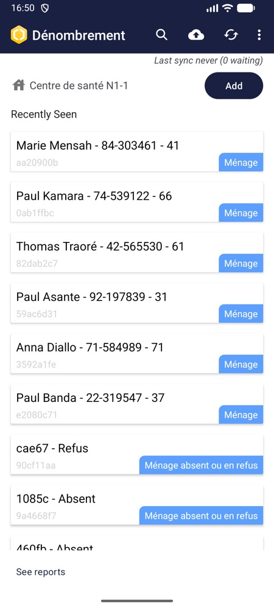
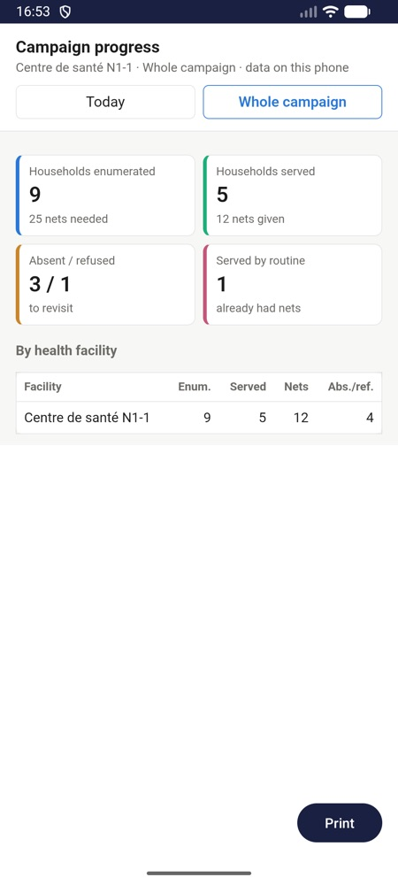
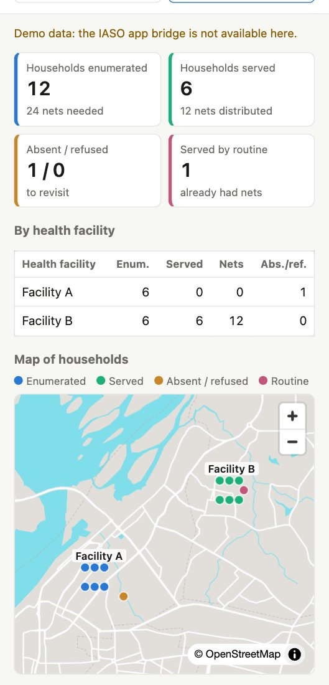
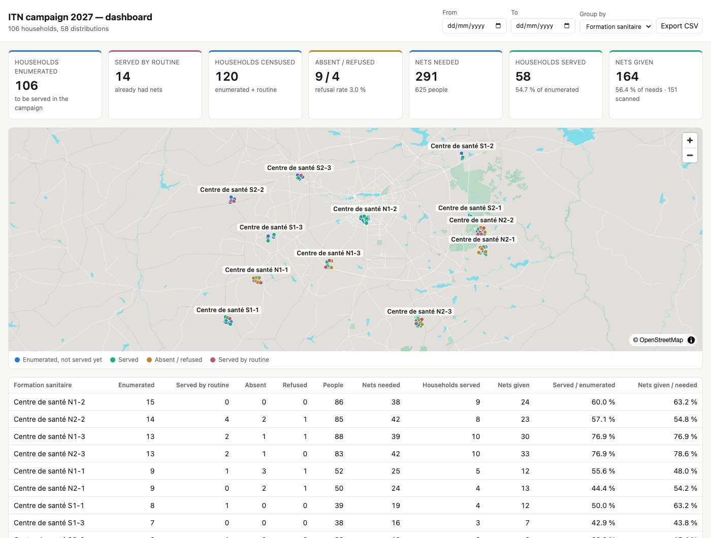

# Configurar una campaña de distribución de MTI con IA

*Configure IASO para una distribución masiva de mosquiteros tratados con insecticida (MTI) con la ayuda de un asistente de IA.*

Esta guía está dirigida a coordinadores de campaña y responsables informáticos que quieren
usar IASO para planificar y supervisar una campaña de MTI. No hace falta ser
desarrollador: un asistente de IA (Claude, ChatGPT…) hace el trabajo técnico, le hace
preguntas sobre su campaña y espera su aprobación antes de cambiar nada en IASO. Hace que la
configuración de la campaña sea más rápida, sobre todo si la mayoría de las decisiones de la
campaña ya están tomadas.

## Antes de empezar

| Necesita | Detalles |
|---|---|
| Una **cuenta IASO** | Puede crear una prueba gratuita en [openiaso.com/pricing](https://www.openiaso.com/pricing/). |
| Un **asistente de IA** | Capaz de ejecutar código Python y de acceder a su servidor IASO: Claude o ChatGPT en el navegador o en su aplicación, o Claude Code (aplicación de escritorio o terminal) con Python 3 en su ordenador. |
| Sus **archivos y decisiones de campaña** | Solo si quiere probar con los datos reales de su campaña. Sus datos geográficos (desde DHIS2, un archivo Excel o un archivo GeoPackage: el asistente los importa por usted, o puede [importarlos usted mismo](../users/reference/user_guide.md#importar-una-piramide-en-una-fuente-de-datos)) y las decisiones de la campaña: distritos cubiertos, regla de asignación de mosquiteros, funciones y tarifas diarias de los trabajadores, lista de almacenes, lista de agentes (vea las preguntas del asistente en el [paso 5](#paso-5-responder-a-las-preguntas-del-asistente)). Si no, el asistente puede proponer datos de demostración para probar primero la configuración. |
| Un **teléfono Android** | Con la [aplicación IASO de Google Play](https://play.google.com/store/apps/details?id=com.bluesquarehub.iaso&hl=es), para probar los proyectos móviles. |

!!! tip "¿Usa otro asistente de IA?"
    Esta guía se ha probado con Claude y ChatGPT. Si tiene dificultades con otro asistente
    de IA, nos interesa su opinión:
    [contáctenos en products@bluesquarehub.com](mailto:products@bluesquarehub.com).

!!! note "Su dirección de IASO"
    Toda esta guía se desarrolla en **[https://app.openiaso.com](https://app.openiaso.com/)**.
    Las cuentas de prueba ya tienen todos los módulos que necesita la campaña (formularios,
    entidades, gestión de stock, enlaces integrados, mapeo DHIS2).

---

## Parte 1: Preparar su cuenta IASO

### Paso 1: Abrir su cuenta IASO

1. Vaya a su cuenta IASO en [app.openiaso.com](https://app.openiaso.com/), o cree una en
   [openiaso.com/pricing](https://www.openiaso.com/pricing/).
2. Elija el **usuario para la configuración**: el asistente trabaja en IASO como este
   usuario. Puede usar el usuario principal de su cuenta recién creada: ya tiene todos los
   permisos que necesita el kit (indicados en `SKILL.md`, sección 1). Lo ideal es crear un
   usuario dedicado a la configuración.

---

## Parte 2: Configurar la campaña con el kit de campaña

El **kit de campaña IASO** es un archivo zip de instrucciones, formularios, plantillas y
pequeños scripts escritos para un asistente de IA. No es un programa que haya que instalar:
usted se lo da al asistente, que lo sigue paso a paso para construir su campaña en IASO. El
asistente trabaja en IASO con los scripts del kit y la clave de acceso que le da en el paso 3.

### Paso 2: Descargar el kit

Descargue el kit en el idioma en el que quiere que trabaje el asistente y descomprímalo en
su ordenador (el kit existe en inglés y en francés):

- **[Kit de campaña en inglés](./setup_bednet_campaign_with_ai_attachments/iaso-campaign-setup.zip)** (zip, 5,6 MB)
- **[Kit de campaña en francés](./setup_bednet_campaign_with_ai_attachments/iaso-campaign-setup-fr.zip)** (zip, 6,1 MB)

Los dos kits contienen los mismos formularios, con etiquetas en inglés y francés.

### Paso 3: Dar al kit acceso a su cuenta IASO

El kit necesita una **clave de acceso** (un "token") para trabajar en su cuenta IASO en su
nombre.

1. Abra este enlace e inicie sesión con el usuario para la configuración:
   **[https://app.openiaso.com/login/?next=/api/apitoken/](https://app.openiaso.com/login/?next=/api/apitoken/)**
2. La página muestra una línea como `{"token": "eyJ0eXAiOiJKV1Qi…"}`. Copie el texto largo
   entre el segundo par de comillas: es su clave de acceso.
3. En la carpeta del kit, abra el archivo `iaso_config.txt` con un editor de texto (Bloc de
   notas, TextEdit…).
4. Compruebe que la línea `IASO_URL=` indica `https://app.openiaso.com`. Pegue su clave de
   acceso después de `IASO_TOKEN=`. Guarde el archivo.
5. Vuelva a comprimir la carpeta del kit en zip.

!!! warning "Mantenga su clave de acceso en privado"
    La clave de acceso funciona como su contraseña. No la pegue nunca en la conversación y
    no comparta nunca el zip una vez que la contiene. Guarde el kit con su clave en un
    lugar seguro: lo necesitará para volver al asistente y hacer cambios más adelante
    (vea el paso 7).

### Paso 4: Dar el kit a su asistente de IA

1. Inicie una nueva conversación en Claude o ChatGPT y adjunte el zip, junto con su archivo
   Excel o GeoPackage si tiene uno. (Con Claude Code, ábralo en la carpeta del kit.)
2. Copie tal cual uno de estos mensajes, según el origen de sus datos geográficos.

**Una demostración, para probar el kit** (la pirámide de demostración del kit y respuestas de
ejemplo):

> Aquí tienes un kit para configurar una campaña de distribución de MTI en IASO.
> Descomprímelo si hace falta, lee `SKILL.md` y síguelo paso a paso para guiarme. Usa solo
> los scripts del kit, ningún conector IASO. Es una demostración: usa la pirámide de
> demostración del kit y propón respuestas de ejemplo para todo en un solo resumen (modo
> demo). Pide mi confirmación antes de cada paso que escriba en IASO, y no te detengas antes
> de la lista del § 12c.

**Sus datos geográficos en un archivo Excel** (adjunto a la conversación):

> Aquí tienes un kit para configurar una campaña de distribución de MTI en IASO.
> Descomprímelo si hace falta, lee `SKILL.md` y síguelo paso a paso para guiarme. Usa solo
> los scripts del kit, ningún conector IASO. Mis unidades organizativas están en el archivo
> Excel adjunto. Hazme las preguntas de la campaña una sección a la vez. Pide mi confirmación
> antes de cada paso que escriba en IASO, y no te detengas antes de la lista del § 12c.

**Sus datos geográficos en DHIS2** (ya configurado en la fuente de datos de IASO):

> Aquí tienes un kit para configurar una campaña de distribución de MTI en IASO.
> Descomprímelo si hace falta, lee `SKILL.md` y síguelo paso a paso para guiarme. Usa solo
> los scripts del kit, ningún conector IASO. Mis unidades organizativas vienen de nuestro
> DHIS2, ya configurado en la fuente de datos de IASO. Hazme las preguntas de la campaña una
> sección a la vez. Pide mi confirmación antes de cada paso que escriba en IASO, y no te
> detengas antes de la lista del § 12c.

**Sus datos geográficos ya están en IASO**:

> Aquí tienes un kit para configurar una campaña de distribución de MTI en IASO.
> Descomprímelo si hace falta, lee `SKILL.md` y síguelo paso a paso para guiarme. Usa solo
> los scripts del kit, ningún conector IASO. Mis unidades organizativas ya están en IASO.
> Hazme las preguntas de la campaña una sección a la vez. Pide mi confirmación antes de cada
> paso que escriba en IASO, y no te detengas antes de la lista del § 12c.

Si tiene dudas, empiece por la demostración: construye todo sobre lugares ficticios, y verá el
resultado antes de preparar sus propios datos. Con un archivo GeoPackage, use el mensaje de
Excel escribiendo «GeoPackage» en lugar de «Excel».

El asistente trabaja en su propio espacio: pídale que le dé como descargas los archivos que
produce (códigos QR, contraseñas de los usuarios, copia de seguridad).

!!! tip "¿El asistente no consigue acceder a IASO?"
    Los scripts del kit necesitan acceder a app.openiaso.com por internet. Si el asistente
    indica "Name or service not known" o que su código no puede conectarse, su código no
    tiene permiso para acceder a esa dirección:

    - **Claude, plan personal**: en **Configuración > Capacidades**, permita que la
      ejecución de código acceda a la red y añada exactamente `app.openiaso.com`
      (`openiaso.com` solo no basta).
    - **Claude, plan Team o Enterprise**: solo un propietario de su organización de Claude
      puede hacerlo, en **Configuración de la organización > Capacidades**. Puede enviarle
      este mensaje: *"Hola, uso Claude para configurar una campaña en IASO. ¿Podrías añadir
      exactamente app.openiaso.com a los dominios a los que puede acceder la ejecución de
      código de Claude (Configuración de la organización > Capacidades)? Sin eso, Claude no
      puede acceder a nuestro servidor IASO. ¡Gracias!"*
    - **ChatGPT** y otros asistentes: compruebe en su configuración que la ejecución de
      código puede acceder a internet, o a esta dirección.

    Después pídale que lo vuelva a intentar.

### Paso 5: Responder a las preguntas del asistente

El asistente hace sus preguntas un tema a la vez (en una demostración, propone todas las
respuestas de una vez, en un solo resumen para aprobar). Cuantas más decisiones haya tomado
ya, más rápida será la configuración:

| Tema | Preguntas | Qué preparar |
|---|---|---|
| Campaña | nombre, país, idiomas de los formularios, distritos cubiertos, cuántos mosquiteros por hogar | la lista de distritos, la regla de asignación |
| Geografía | de dónde vienen sus lugares, en qué nivel se registran los hogares (aldea, establecimiento de salud…) | su configuración DHIS2 en IASO, o su archivo Excel o GeoPackage |
| Proyectos | qué proyectos móviles necesita (empadronamiento, distribución, grupos especiales, trabajadores, stock, supervisión) | — |
| Informes | qué paneles e informes móviles, el mapa de hogares y sus nombres de lugares, y quién puede abrir cada página | la lista de personas que siguen la campaña |
| Trabajadores | las funciones, las tarifas diarias, quién valida la asistencia | la escala de pagos |
| Stock | los almacenes seguidos, el número de mosquiteros por fardo | la lista de almacenes |
| Usuarios | quién usa qué proyecto, en qué zona | la lista de agentes |

¿Aún no está todo decidido? Puede probar igualmente la configuración de la campaña: el
asistente puede proponer datos de demostración (pirámide de demostración, ejemplos de
distritos, almacenes y agentes) que luego sustituirá por los suyos.

Después, el asistente construye la campaña paso a paso, pidiendo su aprobación cada vez:
datos geográficos, proyectos, formularios, registros, stock, usuarios, paneles e informes
móviles.

Puede instalar la aplicación IASO en cuanto el asistente muestre los códigos QR, pero el
teléfono muestra poco hasta que existe el resto:

| Después de | En el teléfono |
|---|---|
| los proyectos | la aplicación se configura con el código QR del proyecto, pero aún no muestra nada |
| los formularios y los usuarios | un agente inicia sesión, sincroniza y ve los formularios |
| los registros y sus seguimientos | los hogares y los trabajadores se pueden registrar y volver a encontrar |
| el stock | los formularios de stock; los saldos aparecen tras una primera recepción |
| los informes móviles | el informe se abre desde la aplicación |

La primera prueba útil en un teléfono se hace, por tanto, una vez creados los usuarios, hacia
los dos tercios de la sesión.

### Paso 6: Probar en un teléfono

1. **Instale la aplicación IASO** en un teléfono Android desde
   [Google Play](https://play.google.com/store/apps/details?id=com.bluesquarehub.iaso&hl=es)
   (o escanee el código QR de Play Store que le da el asistente).
2. **Elija el usuario de prueba**: un usuario de prueba creado por el asistente, o su propio
   usuario (el asistente propone añadirle a los proyectos de la campaña). En ambos casos, este usuario debe tener los proyectos que quiere probar: en
   IASO, vaya a **Admin > Usuarios**, edite el usuario y, en **Proyectos**, seleccione los
   proyectos que va a probar. Para probar los distintos proyectos y pasar de uno a otro,
   selecciónelos todos.
3. **Encuentre los códigos QR** en IASO: abra el menú y vaya a **Admin > Proyectos**. Cada
   proyecto móvil de la campaña aparece allí, con su código QR listo para escanear.
4. **Abra la aplicación IASO** en el teléfono, elija escanear un código QR y escanee el
   código QR del proyecto que va a probar. Acepte las solicitudes de permisos que
   aparezcan (cámara, ubicación…).
5. **Inicie sesión** con el usuario elegido en el punto 2.
6. Siga la lista de pruebas que le da el asistente: registrar un hogar, volver a
   encontrarlo, distribuir mosquiteros, registrar un trabajador, registrar un movimiento de
   stock.
7. Abra los informes móviles, con red y luego en modo avión.

{ width="220" }
{ width="220" }
{ width="220" }

!!! note "¿Dónde están los formularios de stock?"
    En los servidores que tienen la pantalla de inicio de stock, el proyecto Stock se abre en
    los almacenes y sus formularios. Si no, el asistente añade una pestaña **Data collection**
    al proyecto Stock: ábrala, elija el almacén y aparecen los formularios de stock. Sin esa
    pestaña, los formularios de stock están en **Entities > Update stocks**, luego el
    almacén, luego **Edit** junto a su nombre.

Antes de formar a los equipos de campo, pida al asistente que borre los datos y los usuarios
de prueba.

### Paso 7: Después de la configuración

- Para cambiar algo durante la campaña (una pregunta de un formulario, un nuevo distrito, un
  informe), simplemente pídaselo al asistente: vuelva a él con el kit, que sigue conteniendo
  su clave de acceso. Los formularios que ya se usan en los teléfonos
  deben modificarse con cuidado: el kit le explica al asistente cómo hacerlo.
- Siga la campaña en los paneles web (menú **Pages** en IASO) y en los informes móviles. El
  panel de la campaña y el informe de avance muestran los hogares en un mapa (mapa base del
  servidor de teselas de Bluesquare, a partir de OpenStreetMap): en el panel, haga clic en una
  fila de la tabla para acercarse a ese lugar.

{ .doc-shot }

## Más información

- El kit contiene una guía detallada (`GUIDE.html`) que presenta la campaña fase por fase,
  con capturas de pantalla de cada herramienta.
- [Conceptos de IASO](../users/reference/iaso_concepts.md) y [Módulos de IASO](../users/reference/iaso_modules.md)
- [Aplicación móvil de IASO](../users/reference/iaso_mobile.md)
