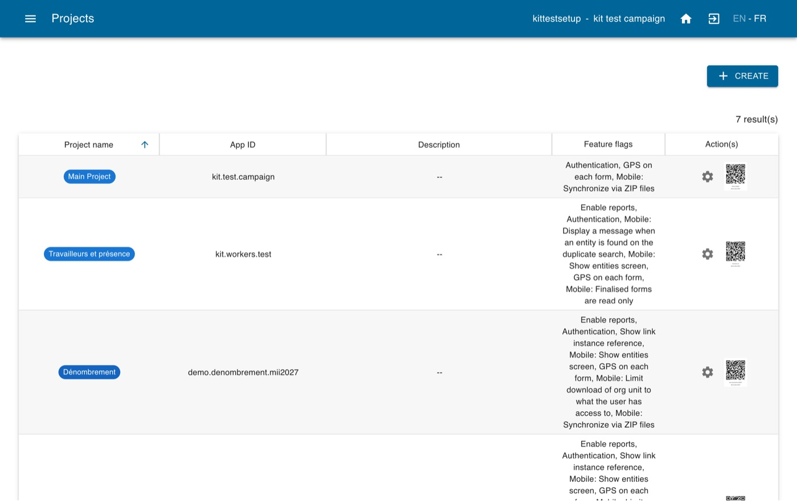
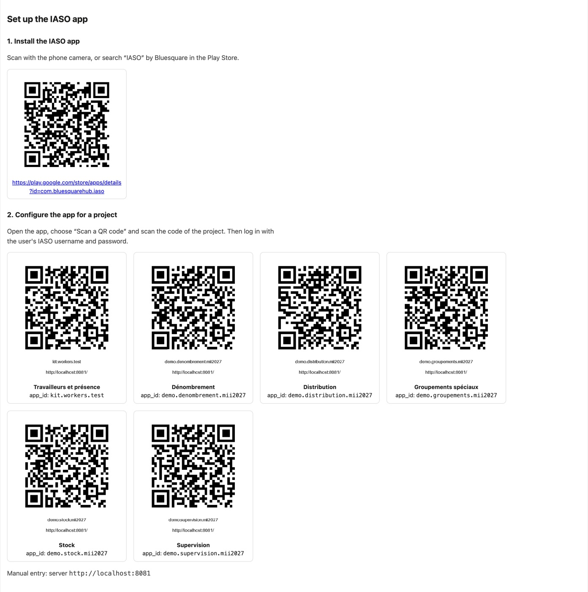
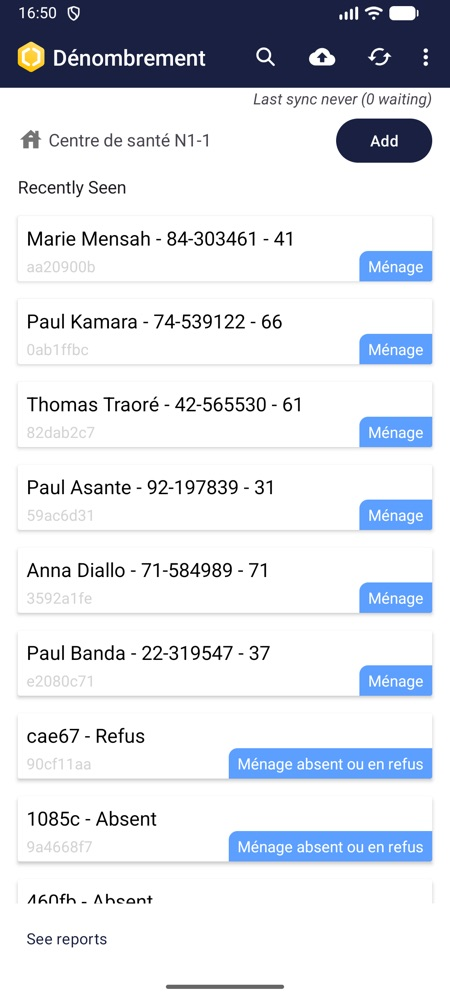
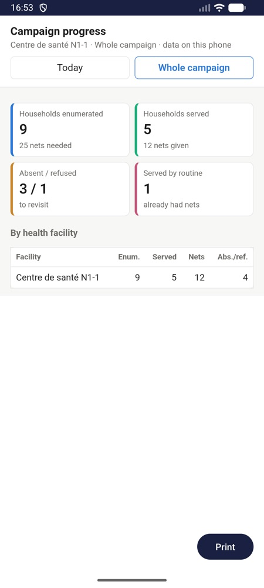
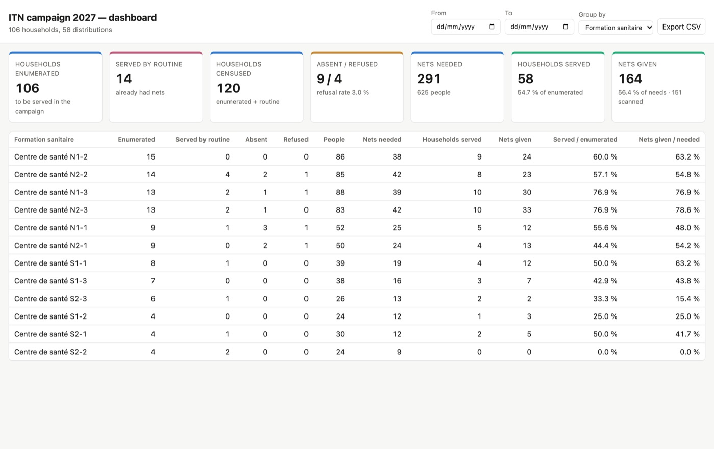

# Configurar una campaña de distribución de mosquiteros con IA

*Configure IASO para una distribución masiva de mosquiteros tratados con insecticida (MTI) con la ayuda de un asistente de IA.*

Esta guía está dirigida a coordinadores de campaña y responsables informáticos que quieren
usar IASO para planificar y supervisar una campaña de mosquiteros. No hace falta ser
desarrollador: un asistente de IA (Claude, ChatGPT…) hace el trabajo técnico, le hace
preguntas sobre su campaña y espera su aprobación antes de cambiar nada en IASO. Hace que la
configuración de la campaña sea más rápida, sobre todo si la mayoría de las decisiones de la
campaña ya están tomadas.

La guía tiene dos partes:

1. **[Preparar su cuenta IASO](#parte-1-preparar-su-cuenta-iaso)**: crear o abrir su cuenta
   y elegir el usuario para la configuración.
2. **[Configurar la campaña](#parte-2-configurar-la-campana-con-el-kit-de-campana)**: dar el
   kit de campaña IASO a su asistente de IA y dejar que importe sus datos geográficos y
   construya las herramientas de la campaña.

## Lo que obtiene al final

| Herramienta | Para | Qué hace |
|---|---|---|
| **Aplicaciones móviles** (hasta seis) | agentes de empadronamiento, agentes de distribución, equipos de grupos especiales, jefes de equipo, encargados de almacén, supervisores | registrar los hogares con un ticket QR, distribuir los mosquiteros una sola vez por hogar, registrar a los trabajadores y su asistencia, seguir los movimientos de stock, rellenar las listas de supervisión |
| **15 formularios listos para usar** | todos los agentes | en inglés y francés, adaptados a su regla de asignación |
| **Registros** | todos | hogares, grupos especiales (prisiones, campamentos, internados…) y trabajadores, que los agentes vuelven a encontrar en el teléfono |
| **Seguimiento del stock** | encargados de almacén | saldo de mosquiteros de cada almacén, calculado a partir de recepciones, salidas, devoluciones, transferencias y pérdidas |
| **Paneles web** | equipo de coordinación | avance de la campaña por región, distrito o establecimiento de salud; asistencia y hoja de pago de los trabajadores |
| **Informes móviles** | jefes de equipo, encargados de almacén | avance, mapa de hogares, asistencia del equipo y stock, disponibles sin conexión en el teléfono |
| **Códigos QR** | formadores | para instalar y configurar la aplicación en cada teléfono en segundos |

{ .doc-shot }

## Antes de empezar

| Necesita | Detalles |
|---|---|
| Una **cuenta IASO** | Puede crear una prueba gratuita en [openiaso.com/pricing](https://www.openiaso.com/pricing/). |
| Un **asistente de IA** | Capaz de ejecutar código Python y de acceder a su servidor IASO: Claude o ChatGPT en el navegador o en su aplicación, o Claude Code (aplicación de escritorio o terminal) con Python 3 en su ordenador. |
| Una **conexión a internet** | Para su asistente de IA e IASO. |
| Sus **archivos y decisiones de campaña** | Solo si quiere probar con los datos reales de su campaña. Sus datos geográficos (desde DHIS2, un archivo Excel o un archivo GeoPackage: el asistente los importa por usted, o puede [importarlos usted mismo](../users/reference/user_guide.md#importar-una-piramide-en-una-fuente-de-datos)) y las decisiones de la campaña: distritos cubiertos, regla de asignación de mosquiteros, funciones y tarifas diarias de los trabajadores, lista de almacenes, lista de agentes (vea las preguntas del asistente en el [paso 5](#paso-5-responder-a-las-preguntas-del-asistente)). Si no, el asistente puede proponer datos de demostración para probar primero la configuración. |
| Un **teléfono Android** | Con la [aplicación IASO de Google Play](https://play.google.com/store/apps/details?id=com.bluesquarehub.iaso&hl=es), para probar las aplicaciones móviles. |

!!! tip "¿Usa otro asistente de IA?"
    Esta guía se ha probado con Claude y ChatGPT. Si tiene dificultades con otro asistente
    de IA, nos interesa su opinión: escriba a
    [products@bluesquarehub.com](mailto:products@bluesquarehub.com).

!!! note "Su dirección de IASO"
    Toda esta guía se desarrolla en **[https://app.openiaso.com](https://app.openiaso.com/)**.
    Las cuentas de prueba ya tienen todos los módulos que necesita la campaña (formularios,
    entidades, gestión de stock, enlaces integrados, mapeo DHIS2).

---

## Parte 1: Preparar su cuenta IASO

### Paso 1: Abrir su cuenta IASO

1. Vaya a su cuenta IASO en [app.openiaso.com](https://app.openiaso.com/), o cree una en
   [openiaso.com/pricing](https://www.openiaso.com/pricing/).
2. Elija el **usuario para la configuración**: el asistente trabaja en IASO como este
   usuario. Puede usar el usuario principal de su cuenta recién creada: ya tiene todos los
   permisos que necesita el kit (indicados en `SKILL.md`, sección 1). Lo ideal es crear un
   usuario dedicado y desactivarlo cuando termine la configuración.

---

## Parte 2: Configurar la campaña con el kit de campaña

El **kit de campaña IASO** es un archivo zip de instrucciones, formularios, plantillas y
pequeños scripts escritos para un asistente de IA. No es un programa que haya que instalar:
usted se lo da al asistente, que lo sigue paso a paso para construir su campaña en IASO. El
asistente trabaja en IASO con los scripts del kit y la clave de acceso que le da en el paso 3.

### Paso 2: Descargar el kit

Descargue el kit en el idioma en el que quiere que trabaje el asistente y descomprímalo en
su ordenador (el kit existe en inglés y en francés):

- **[Kit de campaña en inglés](./setup_bednet_campaign_with_ai_attachments/iaso-campaign-setup.zip)** (zip, 5,5 MB)
- **[Kit de campaña en francés](./setup_bednet_campaign_with_ai_attachments/iaso-campaign-setup-fr.zip)** (zip, 5,9 MB)

Los dos kits contienen los mismos formularios, con etiquetas en inglés y francés.

### Paso 3: Dar al kit acceso a su cuenta IASO

El kit necesita una **clave de acceso** (un "token") para trabajar en su cuenta IASO en su
nombre.

1. Abra este enlace e inicie sesión con el usuario para la configuración:
   **[https://app.openiaso.com/login/?next=/api/apitoken/](https://app.openiaso.com/login/?next=/api/apitoken/)**
2. La página muestra una línea como `{"token": "eyJ0eXAiOiJKV1Qi…"}`. Copie el texto largo
   entre el segundo par de comillas: es su clave de acceso.
3. En la carpeta del kit, abra el archivo `iaso_config.txt` con un editor de texto (Bloc de
   notas, TextEdit…).
4. Compruebe que la línea `IASO_URL=` indica `https://app.openiaso.com`. Pegue su clave de
   acceso después de `IASO_TOKEN=`. Guarde el archivo.
5. Vuelva a comprimir la carpeta del kit en zip.

!!! warning "Mantenga su clave de acceso en privado"
    La clave de acceso funciona como su contraseña. No la pegue nunca en la conversación y
    no comparta nunca el zip una vez que la contiene. Cuando termine la configuración,
    borre la clave de `iaso_config.txt`.

### Paso 4: Dar el kit a su asistente de IA

1. Inicie una nueva conversación en Claude o ChatGPT y adjunte el zip, junto con su archivo
   Excel o GeoPackage si tiene uno. (Con Claude Code, ábralo en la carpeta del kit.)
2. Envíe este mensaje, completado con el origen de sus datos geográficos:

> Aquí tienes un kit para configurar una campaña de distribución de mosquiteros en IASO.
> Descomprímelo, lee `SKILL.md`, `reference/pitfalls.md` y `reference/architecture.md`, y
> luego sigue `SKILL.md` paso a paso para guiarme en la construcción de las herramientas de
> mi campaña. Usa solo los scripts del kit, ningún conector IASO. Empieza comprobando el
> acceso y haciendo una copia de seguridad de mi cuenta. Mis datos geográficos vienen de:
> [mi DHIS2, ya configurado en la fuente de datos / el archivo Excel adjunto / el GeoPackage
> adjunto / una pirámide de demostración / ya están en IASO]. Después hazme las preguntas de
> la campaña un tema a la vez. Muéstrame los códigos QR en cuanto existan las aplicaciones.
> Pide mi confirmación antes de cada paso que modifique IASO. No te detengas antes de la
> lista de comprobación final, y dime al final qué has creado y qué debo probar en un
> teléfono.

El asistente trabaja en su propio espacio: pídale que le dé como descargas los archivos que
produce (códigos QR, contraseñas de los usuarios, copia de seguridad).

!!! tip "¿El asistente no consigue acceder a IASO?"
    Los scripts del kit necesitan acceder a app.openiaso.com por internet. Si el asistente
    indica que su código no puede conectarse, compruebe en su configuración que la ejecución
    de código tiene permiso para acceder a internet (o a esta dirección) y pídale que lo
    vuelva a intentar.

### Paso 5: Responder a las preguntas del asistente

El asistente hace sus preguntas un tema a la vez. Cuantas más decisiones haya tomado ya, más
rápida será la configuración:

| Tema | Preguntas | Qué preparar |
|---|---|---|
| Campaña | nombre, país, idiomas de los formularios, distritos cubiertos, cuántos mosquiteros por hogar | la lista de distritos, la regla de asignación |
| Geografía | de dónde vienen sus lugares, en qué nivel se registran los hogares (aldea, establecimiento de salud…) | su configuración DHIS2 en IASO, o su archivo Excel o GeoPackage |
| Aplicaciones | qué aplicaciones necesita (empadronamiento, distribución, grupos especiales, trabajadores, stock, supervisión) | — |
| Informes | qué paneles e informes móviles, y quién puede abrir cada uno | la lista de personas que siguen la campaña |
| Trabajadores | las funciones, las tarifas diarias, quién valida la asistencia | la escala de pagos |
| Stock | los almacenes seguidos, el número de mosquiteros por fardo | la lista de almacenes |
| Usuarios | quién usa qué aplicación, en qué zona | la lista de agentes |

¿Aún no está todo decidido? Puede probar igualmente la configuración de la campaña: el
asistente puede proponer datos de demostración (pirámide de demostración, ejemplos de
distritos, almacenes y agentes) que luego sustituirá por los suyos.

Después, el asistente construye la campaña paso a paso, pidiendo su aprobación cada vez:
datos geográficos, aplicaciones, formularios, registros, stock, usuarios, paneles e informes
móviles.

{ .doc-shot }

### Paso 6: Probar en un teléfono

1. **Instale la aplicación IASO** en un teléfono Android desde
   [Google Play](https://play.google.com/store/apps/details?id=com.bluesquarehub.iaso&hl=es)
   (o escanee el código QR de Play Store que le da el asistente).
2. **Elija el usuario de prueba**: un usuario de prueba creado por el asistente, o su propio
   usuario. En ambos casos, este usuario debe tener las aplicaciones que quiere probar: en
   IASO, vaya a **Admin > Usuarios**, edite el usuario y, en **Proyectos**, seleccione las
   aplicaciones que va a probar. Para probar las distintas aplicaciones y pasar de una a
   otra, selecciónelas todas.
3. **Encuentre los códigos QR** en IASO: abra el menú y vaya a **Admin > Proyectos**. Cada
   aplicación móvil de la campaña aparece allí, con su código QR listo para escanear.
4. **Abra la aplicación IASO** en el teléfono, elija escanear un código QR y escanee el
   código QR de la aplicación que va a probar. Acepte las solicitudes de permisos que
   aparezcan (cámara, ubicación…).
5. **Inicie sesión** con el usuario elegido en el punto 2.
6. Siga la lista de pruebas que le da el asistente: registrar un hogar, volver a
   encontrarlo, distribuir mosquiteros, registrar un trabajador, registrar un movimiento de
   stock.
7. Abra los informes móviles, con red y luego en modo avión.

{ width="220" }
{ width="220" }

Antes de formar a los equipos de campo, pida al asistente que borre los datos y los usuarios
de prueba.

### Paso 7: Después de la configuración

- Borre la clave de acceso de `iaso_config.txt` y elimine el zip que la contenía.
- Si creó un usuario dedicado a la configuración, desactívelo.
- Para cambiar algo durante la campaña (una pregunta de un formulario, un nuevo distrito, un
  informe), vuelva al asistente con el kit. Los formularios que ya se usan en los teléfonos
  deben modificarse con cuidado: el kit le explica al asistente cómo hacerlo.
- Siga la campaña en los paneles web (menú **Pages** en IASO) y en los informes móviles.

{ .doc-shot }

## Más información

- El kit contiene una guía detallada (`GUIDE.html`) que presenta la campaña fase por fase,
  con capturas de pantalla de cada herramienta.
- [Conceptos de IASO](../users/reference/iaso_concepts.md) y [Módulos de IASO](../users/reference/iaso_modules.md)
- [Aplicación móvil de IASO](../users/reference/iaso_mobile.md)
