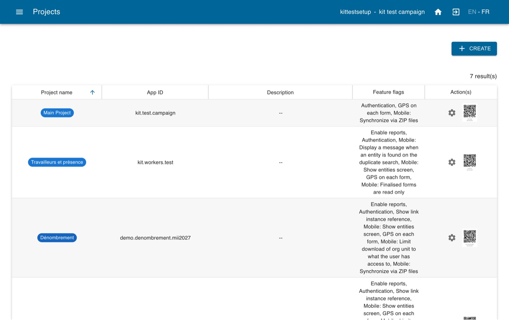
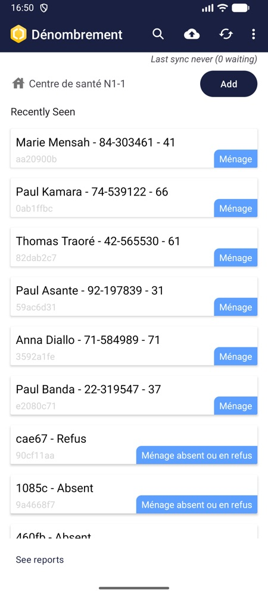
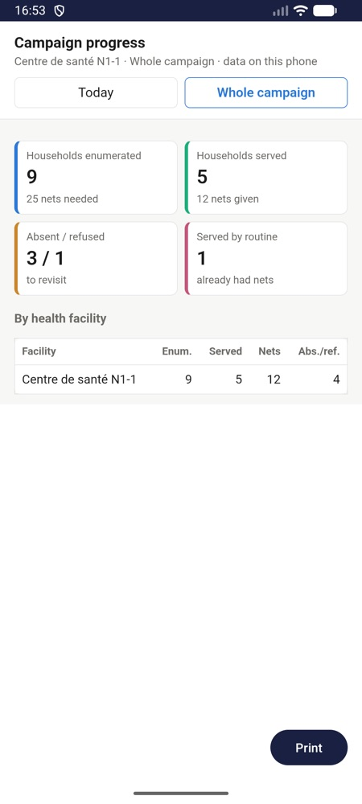
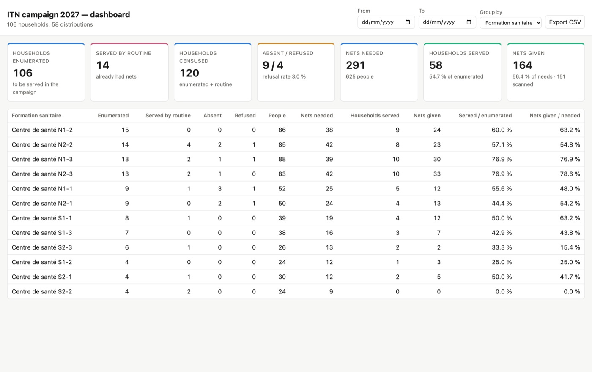

# Configurer une campagne de distribution de moustiquaires avec l'IA

*Configurez IASO pour une distribution de masse de moustiquaires imprégnées d'insecticide (MII) avec l'aide d'un assistant IA.*

Ce guide s'adresse aux coordinateurs de campagne et aux points focaux informatiques qui
veulent utiliser IASO pour planifier et suivre une campagne MII. Pas besoin d'être
développeur : un assistant IA (Claude, ChatGPT…) fait le travail technique, vous pose des
questions sur votre campagne et attend votre accord avant de modifier quoi que ce soit dans
IASO. Il rend la configuration de la campagne plus rapide, surtout si la plupart des
décisions de la campagne sont déjà prises.

Le guide comporte deux parties :

1. **[Préparer votre compte IASO](#partie-1-preparer-votre-compte-iaso)** : créer ou ouvrir
   votre compte et choisir l'utilisateur pour la configuration.
2. **[Configurer la campagne](#partie-2-configurer-la-campagne-avec-le-kit-de-campagne)** :
   donner le kit de campagne IASO à votre assistant IA et le laisser importer vos données
   géographiques et construire les outils de la campagne.

## Ce que vous obtenez à la fin

| Outil | Pour | Ce qu'il fait |
|---|---|---|
| **Projets mobiles** (jusqu'à six) | agents de dénombrement, agents de distribution, équipes groupes spéciaux, chefs d'équipe, gestionnaires de stock, superviseurs | enregistrer les ménages avec un ticket QR, distribuer les moustiquaires une seule fois par ménage, enregistrer les travailleurs et leur présence, suivre les mouvements de stock, remplir les grilles de supervision |
| **15 formulaires prêts à l'emploi** | tous les agents | en français et en anglais, adaptés à votre règle d'attribution |
| **Registres** | tous | ménages, groupes spéciaux (prisons, camps, internats…) et travailleurs, que les agents retrouvent sur le téléphone |
| **Suivi du stock** | gestionnaires de stock | solde de moustiquaires de chaque magasin, calculé à partir des réceptions, sorties, retours, transferts et pertes |
| **Tableaux de bord web** | équipe de coordination | avancement de la campagne par région, district ou formation sanitaire ; présence et fiche de paiement des travailleurs |
| **Rapports mobiles** | chefs d'équipe, gestionnaires de stock | avancement, carte des ménages, présence de l'équipe et stock, disponibles hors ligne sur le téléphone |
| **QR codes** | formateurs | pour installer l'application IASO et la configurer pour chaque projet en quelques secondes |

{ .doc-shot }

## Avant de commencer

| Il vous faut | Détails |
|---|---|
| Un **compte IASO** | Vous pouvez créer un essai gratuit sur [openiaso.com/pricing](https://www.openiaso.com/pricing/). |
| Un **assistant IA** | Capable d'exécuter du code Python et d'accéder à votre serveur IASO : Claude ou ChatGPT dans le navigateur ou dans leur application, ou Claude Code (application de bureau ou terminal) avec Python 3 sur votre ordinateur. |
| Vos **fichiers et décisions de campagne** | Seulement si vous voulez tester avec les données réelles de votre campagne. Vos données géographiques (depuis DHIS2, un fichier Excel ou un fichier GeoPackage : l'assistant les importe pour vous, ou vous pouvez [les importer vous-même](../users/reference/user_guide.md#importer-une-pyramide-dans-une-source-de-donnees)) et les décisions de la campagne : districts couverts, règle d'attribution des moustiquaires, rôles et taux journaliers des travailleurs, liste des magasins, liste des agents (voir les questions de l'assistant à l'[étape 5](#etape-5-repondre-aux-questions-de-lassistant)). Sinon, l'assistant peut proposer des données de démonstration pour tester d'abord la configuration. |
| Un **téléphone Android** | Avec l'[application IASO sur Google Play](https://play.google.com/store/apps/details?id=com.bluesquarehub.iaso&hl=fr), pour tester les projets mobiles. |

!!! tip "Vous utilisez un autre assistant IA ?"
    Ce guide a été testé avec Claude et ChatGPT. Si vous rencontrez des difficultés avec un
    autre assistant IA, vos retours nous intéressent :
    [contactez-nous à products@bluesquarehub.com](mailto:products@bluesquarehub.com).

!!! note "Votre adresse IASO"
    Tout ce guide se déroule sur **[https://app.openiaso.com](https://app.openiaso.com/)**.
    Les comptes d'essai ont déjà tous les modules nécessaires à la campagne (formulaires,
    entités, gestion de stock, liens intégrés, mapping DHIS2).

---

## Partie 1 : Préparer votre compte IASO

### Étape 1 : Ouvrir votre compte IASO

1. Allez sur votre compte IASO sur [app.openiaso.com](https://app.openiaso.com/), ou créez-en
   un sur [openiaso.com/pricing](https://www.openiaso.com/pricing/).
2. Choisissez l'**utilisateur pour la configuration** : l'assistant travaille dans IASO en
   tant que cet utilisateur. Vous pouvez utiliser l'utilisateur principal de votre compte
   nouvellement créé : il a déjà toutes les permissions dont le kit a besoin (listées dans
   `SKILL.md`, section 1). Idéalement, créez un utilisateur dédié à la
   configuration.

---

## Partie 2 : Configurer la campagne avec le kit de campagne

Le **kit de campagne IASO** est un fichier zip d'instructions, de formulaires, de modèles et
de petits scripts écrits pour un assistant IA. Ce n'est pas un logiciel à installer : vous le
donnez à l'assistant, qui le suit étape par étape pour construire votre campagne dans IASO.
L'assistant travaille dans IASO avec les scripts du kit et la clé d'accès que vous lui
donnez à l'étape 3.

### Étape 2 : Télécharger le kit

Téléchargez le kit dans la langue dans laquelle l'assistant doit travailler, et
décompressez-le sur votre ordinateur :

- **[Kit de campagne en français](./setup_bednet_campaign_with_ai_attachments/iaso-campaign-setup-fr.zip)** (zip, 5,9 Mo)
- **[Kit de campagne en anglais](./setup_bednet_campaign_with_ai_attachments/iaso-campaign-setup.zip)** (zip, 5,5 Mo)

Les deux kits contiennent les mêmes formulaires, avec des libellés en français et en anglais.

### Étape 3 : Donner au kit l'accès à votre compte IASO

Le kit a besoin d'une **clé d'accès** (un « token ») pour travailler dans votre compte IASO
en votre nom.

1. Ouvrez ce lien et connectez-vous avec l'utilisateur pour la configuration :
   **[https://app.openiaso.com/login/?next=/api/apitoken/](https://app.openiaso.com/login/?next=/api/apitoken/)**
2. La page affiche une ligne comme `{"token": "eyJ0eXAiOiJKV1Qi…"}`. Copiez le long texte
   entre la deuxième paire de guillemets : c'est votre clé d'accès.
3. Dans le dossier du kit, ouvrez le fichier `iaso_config.txt` avec un éditeur de texte
   (Bloc-notes, TextEdit…).
4. Vérifiez que la ligne `IASO_URL=` indique `https://app.openiaso.com`. Collez votre clé
   d'accès après `IASO_TOKEN=`. Enregistrez le fichier.
5. Recompressez le dossier du kit en zip.

!!! warning "Gardez votre clé d'accès privée"
    La clé d'accès fonctionne comme votre mot de passe. Ne la collez jamais dans la
    conversation et ne partagez jamais le zip une fois qu'il la contient. Gardez le kit
    avec sa clé en lieu sûr : il vous servira pour revenir vers l'assistant et faire des
    modifications plus tard (voir l'étape 7).

### Étape 4 : Donner le kit à votre assistant IA

1. Démarrez une nouvelle conversation dans Claude ou ChatGPT et joignez le zip, ainsi que
   votre fichier Excel ou GeoPackage si vous en avez un. (Avec Claude Code, ouvrez-le plutôt
   dans le dossier du kit.)
2. Envoyez ce message, complété avec l'origine de vos données géographiques :

> Voici un kit pour configurer une campagne de distribution de moustiquaires dans IASO.
> Décompresse-le, lis `SKILL.md`, `reference/pitfalls.md` et `reference/architecture.md`,
> puis suis `SKILL.md` étape par étape pour me guider dans la construction des outils de ma
> campagne. Utilise uniquement les scripts du kit, aucun connecteur IASO. Commence par
> vérifier l'accès et faire une sauvegarde de mon compte. Mes données géographiques viennent
> de : [mon DHIS2, déjà configuré sur la source de données / le fichier Excel joint / le
> GeoPackage joint / une pyramide de démonstration / elles sont déjà dans IASO]. Pose-moi
> ensuite les questions de la campagne un thème à la fois. Montre-moi les QR codes dès que
> les projets existent. Demande ma confirmation avant chaque étape qui modifie IASO. Ne
> t'arrête pas avant la liste de contrôle finale, et dis-moi à la fin ce que tu as créé et ce
> que je dois tester sur un téléphone.

L'assistant travaille dans son propre espace : demandez-lui de vous donner en téléchargement
les fichiers qu'il produit (QR codes, mots de passe des utilisateurs, sauvegarde).

!!! tip "L'assistant n'arrive pas à joindre IASO ?"
    Les scripts du kit doivent accéder à app.openiaso.com par internet. Si l'assistant
    indique que son code ne peut pas se connecter, vérifiez dans ses paramètres que
    l'exécution de code a le droit d'accéder à internet (ou à cette adresse), puis
    demandez-lui de réessayer.

### Étape 5 : Répondre aux questions de l'assistant

L'assistant pose ses questions un thème à la fois. Plus vous avez déjà pris de décisions,
plus la configuration est rapide :

| Thème | Questions | À préparer |
|---|---|---|
| Campagne | nom, pays, langues des formulaires, districts couverts, nombre de moustiquaires par ménage | la liste des districts, la règle d'attribution |
| Géographie | d'où viennent vos lieux, à quel niveau les ménages sont enregistrés (village, formation sanitaire…) | vos paramètres DHIS2 dans IASO, ou votre fichier Excel ou GeoPackage |
| Projets | quels projets mobiles sont nécessaires (dénombrement, distribution, groupes spéciaux, travailleurs, stock, supervision) | — |
| Rapports | quels tableaux de bord et rapports mobiles, et qui peut ouvrir chacun | la liste des personnes qui suivent la campagne |
| Travailleurs | les rôles, les taux journaliers, qui valide la présence | la grille de paiement |
| Stock | les magasins suivis, le nombre de moustiquaires par balle | la liste des magasins |
| Utilisateurs | qui utilise quel projet, dans quelle zone | la liste des agents |

Tout n'est pas encore décidé ? Vous pouvez quand même tester la configuration de la
campagne : l'assistant peut proposer des données de démonstration (pyramide de
démonstration, exemples de districts, de magasins et d'agents) que vous remplacerez ensuite
par les vôtres.

L'assistant construit ensuite la campagne étape par étape, en demandant votre accord à
chaque fois : données géographiques, projets, formulaires, registres, stock,
utilisateurs, tableaux de bord et rapports mobiles.

### Étape 6 : Tester sur un téléphone

1. **Installez l'application IASO** sur un téléphone Android depuis
   [Google Play](https://play.google.com/store/apps/details?id=com.bluesquarehub.iaso&hl=fr)
   (ou scannez le QR code du Play Store que l'assistant vous donne).
2. **Choisissez l'utilisateur de test** : un utilisateur de test créé par l'assistant, ou
   votre propre utilisateur. Dans les deux cas, cet utilisateur doit avoir les projets
   que vous voulez tester : dans IASO, allez dans **Admin > Utilisateurs**, modifiez
   l'utilisateur et, dans **Projets**, sélectionnez les projets à tester. Pour essayer les
   différents projets et passer de l'un à l'autre, sélectionnez-les tous.
3. **Trouvez les QR codes** dans IASO : ouvrez le menu et allez dans **Admin > Projets**.
   Chaque projet mobile de la campagne y est listé, avec son QR code prêt à scanner.
4. **Ouvrez l'application IASO** sur le téléphone, choisissez de scanner un QR code et
   scannez le QR code du projet à tester. Acceptez les demandes d'autorisation qui
   s'affichent (appareil photo, localisation…).
5. **Connectez-vous** avec l'utilisateur choisi au point 2.
6. Suivez la liste de tests que l'assistant vous donne : enregistrer un ménage, le
   retrouver, distribuer des moustiquaires, enregistrer un travailleur, saisir un mouvement
   de stock.
7. Ouvrez les rapports mobiles, avec réseau puis en mode avion.

{ width="220" }
{ width="220" }

Avant de former les équipes de terrain, demandez à l'assistant de supprimer les données et
les utilisateurs de test.

### Étape 7 : Après la configuration

- Pour modifier quelque chose pendant la campagne (une question d'un formulaire, un nouveau
  district, un rapport), demandez-le simplement à l'assistant : revenez vers lui avec le
  kit, qui contient toujours votre clé d'accès. Les formulaires déjà utilisés
  sur les téléphones doivent être modifiés avec précaution : le kit explique à l'assistant
  comment faire.
- Suivez la campagne dans les tableaux de bord web (menu **Pages** dans IASO) et dans les
  rapports mobiles.

{ .doc-shot }

## En savoir plus

- Le kit contient un guide détaillé (`GUIDE.html`) qui présente la campagne phase par phase,
  avec des captures d'écran de chaque outil.
- [Concepts IASO](../users/reference/iaso_concepts.md) et [Modules IASO](../users/reference/iaso_modules.md)
- [Application mobile IASO](../users/reference/iaso_mobile.md)
