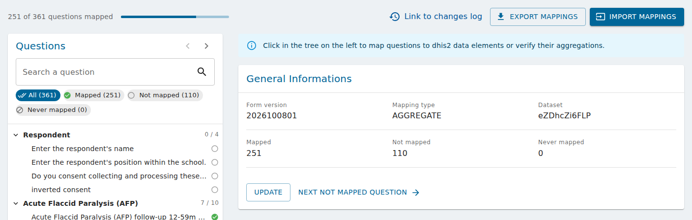
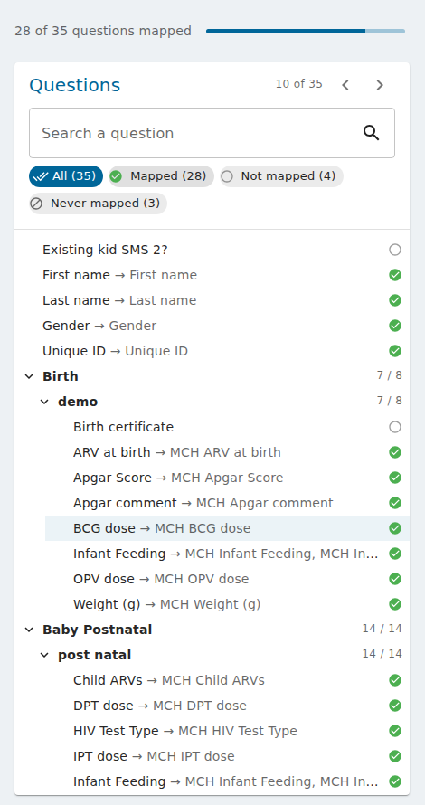
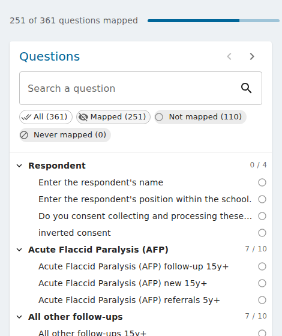
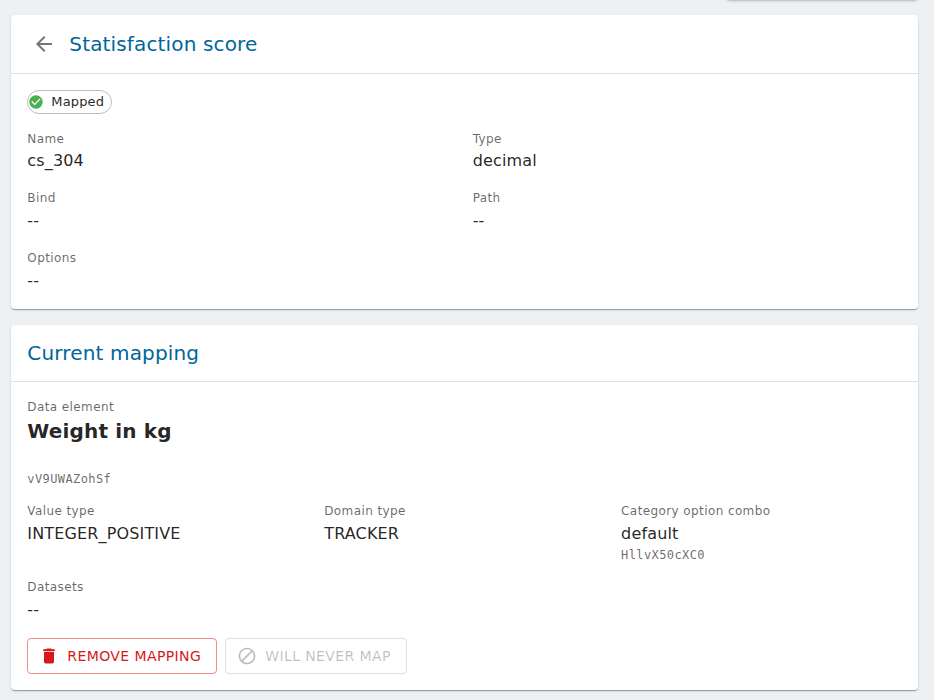

# Map a form to DHIS2

To export submissions to DHIS2, each question of a form version is linked ("mapped") to a DHIS2
data element. This page explains how to do it on the mapping page of a form version.

Before you start:

- the account needs a DHIS2 data source with its credentials, see
  [Set up the DHIS2 login in IASO](setup_dhis2_login_in_iaso.md);
- choose the mapping type (Aggregate, Event or Event Tracker), see
  [which mapping type to choose](import_export_dhis2_mappings.md#which-mapping-type-to-choose).

## Open the mapping page

In **Forms > DHIS2 mappings**, click **Create** to map a form version, or open an existing mapping.

When nothing is selected, the page shows the **General information** of the mapping:

{ .doc-shot }

- at the top, how many questions are mapped, the **Link to changes log**, and the **Export
  mappings** / **Import mappings** buttons (see
  [Import and export DHIS2 mappings](import_export_dhis2_mappings.md));
- the form version, the mapping type, and the DHIS2 dataset or program;
- how many questions are **Mapped**, **Not mapped** and **Never mapped**;
- for Event and Event Tracker mappings, the **Event date source**: the date of the DHIS2 event is
  the creation date of the submission, or the start of its period. Click **Update** to save it;
- **Next not mapped question** opens the first question still to map.

## Find a question

The questions of the form are listed on the left, in their groups.

{ .doc-shot-lg }

- Each group shows how many of its questions are mapped (e.g. `7 / 8`).
- Each question shows its status: a green check when mapped, an empty circle when not mapped yet,
  a crossed circle when it will never be mapped. A mapped question also shows its DHIS2 data
  element after the arrow.
- Hover a question to read its full label, name and type.

To find a question:

- type in **Search a question**: the label, the name of the question or its DHIS2 data element
  (case and accents are ignored). Searching a group name shows all the questions of the group;
- click a status chip to hide those questions, e.g. hide **Mapped** to see only what is left to
  do. **All** shows everything again.

{ .doc-shot }

To go through the questions one by one, use the arrows next to **Questions**, or **Alt+↓** and
**Alt+↑**. They follow the questions currently listed, so you can filter first. Press **Esc**
(or the arrow before the question name) to go back to the general information.

## Map a question

Click a question to open it:

{ .doc-shot-lg }

- the first card describes the question: its status, group, name, type, bind, path and options;
- **Current mapping** shows the DHIS2 data element it is mapped to, with its id, value type,
  domain type, category option combo and datasets.

To map the question, in **Change the mapping**:

1. search the DHIS2 data element by its name, code or id. For an Event Tracker mapping, choose
   first between a **Program data element** and a **Tracked Entity Attribute**;
2. check the **Proposed mapping**. A red message warns when the same data element (and category
   option combo) is already used by another question;
3. click **Confirm**.

Some questions don't need to go to DHIS2 (notes, intermediate calculations, metadata...): click
**Will never map**. They are counted apart and left out of mapping exports; an import shows them as
conflicts instead of overwriting them. To undo it, map the question.

**Remove mapping** removes the current mapping: the question is not mapped anymore.

### Questions with choices

A "select all that apply" question is mapped choice by choice: open the question in the tree and
map each of its choices.

### Send the org unit of the submission (Event Tracker)

When the proposed data element or attribute has the value type **ORGANISATION_UNIT**, a
**Use instance property to fill in this answer** list appears:

- **Use the value from the form's answer** (default): the answer to the question is sent;
- **Instance orgunit**: the DHIS2 id of the org unit of the submission is sent instead of the
  answer.

!!! note
    The value is only sent when the question is answered in the submission. Map a question that
    is always answered (e.g. a hidden or calculated field).
