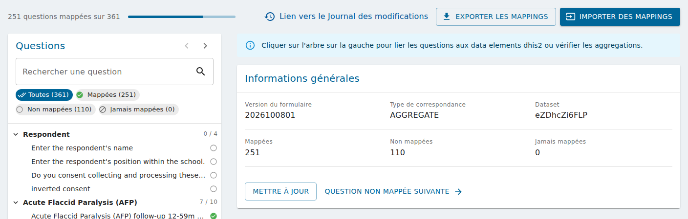
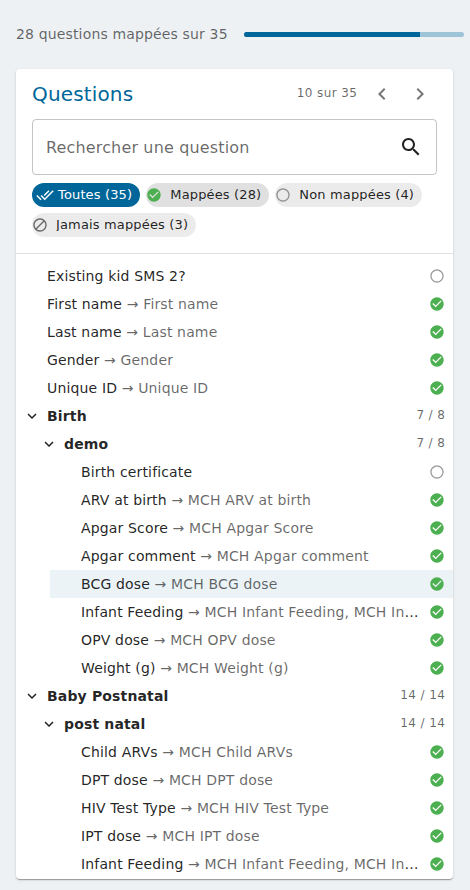
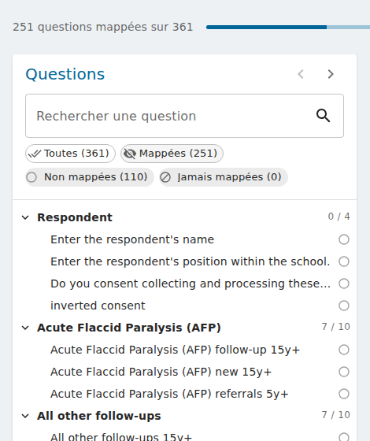
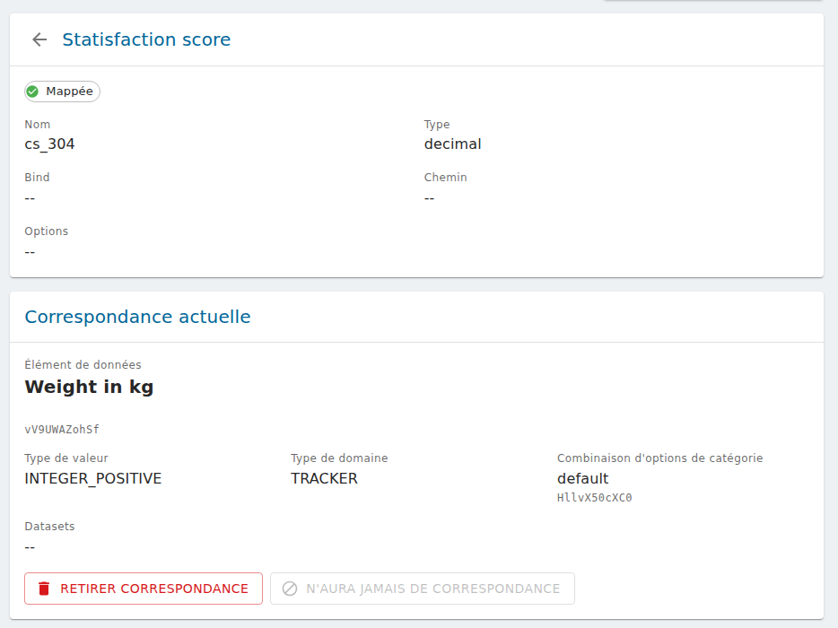

# Mapper un formulaire vers DHIS2

Pour exporter les soumissions vers DHIS2, chaque question d'une version de formulaire est liée
(« mappée ») à un data element DHIS2. Cette page explique comment le faire sur la page de mapping
d'une version de formulaire.

Avant de commencer :

- le compte doit avoir une source de données DHIS2 avec ses identifiants, voir
  [Configurer la connexion DHIS2 dans IASO](setup_dhis2_login_in_iaso.md) ;
- choisissez le type de mapping (Aggregate, Event ou Event Tracker), voir
  [quel type de mapping choisir](import_export_dhis2_mappings.md#quel-type-de-mapping-choisir).

## Ouvrir la page de mapping

Dans **Formulaires > Correspondances avec DHIS2**, cliquez sur **Créer** pour mapper une version
de formulaire, ou ouvrez un mapping existant.

Quand aucune question n'est sélectionnée, la page montre les **Informations générales** du
mapping :

{ .doc-shot }

- en haut, le nombre de questions mappées, le **Lien vers le Journal des modifications**, et les
  boutons **Exporter les mappings** / **Importer des mappings** (voir
  [Importer et exporter des mappings DHIS2](import_export_dhis2_mappings.md)) ;
- la version du formulaire, le type de mapping, et le dataset ou le programme DHIS2 ;
- le nombre de questions **Mappées**, **Non mappées** et **Jamais mappées** ;
- pour les mappings Event et Event Tracker, la **Source pour la date d'évènement** : la date de
  l'évènement DHIS2 est la date de création de la soumission, ou le début de sa période. Cliquez
  sur **Mettre à jour** pour l'enregistrer ;
- **Question non mappée suivante** ouvre la première question qui reste à mapper.

## Trouver une question

Les questions du formulaire sont listées à gauche, dans leurs groupes.

{ .doc-shot-lg }

- Chaque groupe indique combien de ses questions sont mappées (p. ex. `7 / 8`).
- Chaque question indique son statut : une coche verte quand elle est mappée, un cercle vide
  quand elle ne l'est pas encore, un cercle barré quand elle ne sera jamais mappée. Une question
  mappée montre aussi son data element DHIS2 après la flèche.
- Survolez une question pour lire son libellé complet, son nom et son type.

Pour trouver une question :

- tapez dans **Rechercher une question** : le libellé, le nom de la question ou son data element
  DHIS2 (sans tenir compte des majuscules ni des accents). Rechercher le nom d'un groupe montre
  toutes les questions du groupe ;
- cliquez sur un statut pour masquer ces questions, p. ex. masquez **Mappées** pour ne voir que ce
  qui reste à faire. **Toutes** réaffiche tout.

{ .doc-shot }

Pour parcourir les questions une à une, utilisez les flèches à côté de **Questions**, ou
**Alt+↓** et **Alt+↑**. Elles suivent les questions affichées : vous pouvez filtrer d'abord.
Appuyez sur **Échap** (ou sur la flèche avant le nom de la question) pour revenir aux
informations générales.

## Mapper une question

Cliquez sur une question pour l'ouvrir :

{ .doc-shot-lg }

- la première carte décrit la question : son statut, son groupe, son nom, son type, son bind, son
  chemin et ses options ;
- **Correspondance actuelle** montre le data element DHIS2 auquel elle est mappée, avec son id,
  son type de valeur, son type de domaine, sa combinaison d'options de catégorie et ses datasets.

Pour mapper la question, dans **Modifier la correspondance** :

1. cherchez le data element DHIS2 par son nom, son code ou son id. Pour un mapping Event Tracker,
   choisissez d'abord entre un **Data element du programme** et un **Attribut de l'entité
   suivie** ;
2. vérifiez la **Correspondance proposée**. Un message rouge prévient quand le même data element
   (et la même combinaison d'options de catégorie) est déjà utilisé par une autre question ;
3. cliquez sur **Confirmer**.

Certaines questions n'ont pas à aller dans DHIS2 (notes, calculs intermédiaires, métadonnées...) :
cliquez sur **N'aura jamais de correspondance**. Elles sont comptées à part et ne sont pas
exportées ; un import les montre comme conflits au lieu de les écraser. Pour annuler, mappez la
question.

**Retirer correspondance** supprime le mapping actuel : la question n'est plus mappée.

### Questions à choix

Une question « choix multiples » (select all that apply) est mappée choix par choix : ouvrez la
question dans l'arbre et mappez chacun de ses choix.

### Envoyer l'unité d'organisation de la soumission (Event Tracker)

Quand le data element ou l'attribut proposé est de type **ORGANISATION_UNIT**, une liste
**Utiliser la propriété d'une instance pour remplir cette question** apparaît :

- **Utiliser la valeur de la réponse du formulaire** (par défaut) : la réponse à la question est
  envoyée ;
- **Unité d'org. de l'instance** : l'id DHIS2 de l'unité d'organisation de la soumission est
  envoyé à la place de la réponse.

!!! note
    La valeur n'est envoyée que si la question a une réponse dans la soumission. Mappez une
    question qui a toujours une réponse (p. ex. un champ caché ou calculé).
